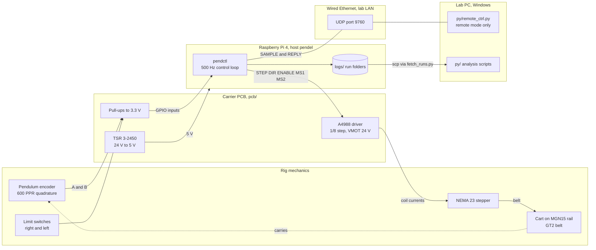
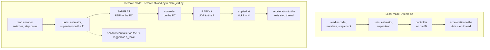
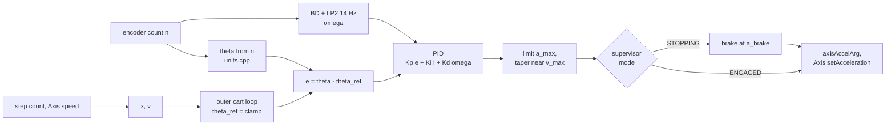
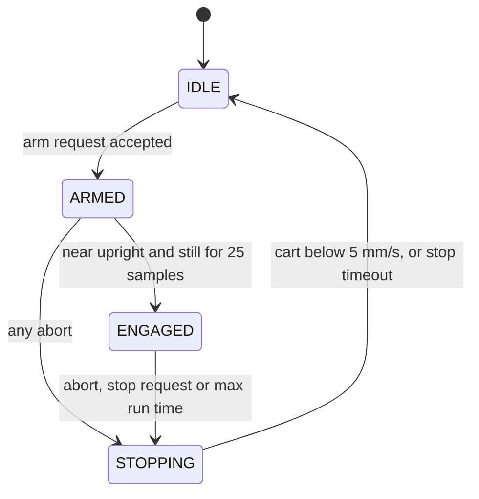
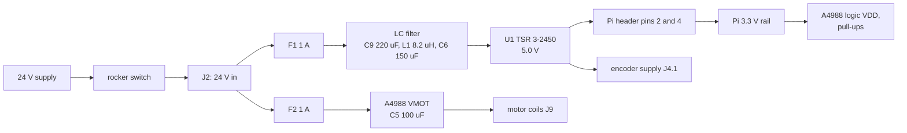
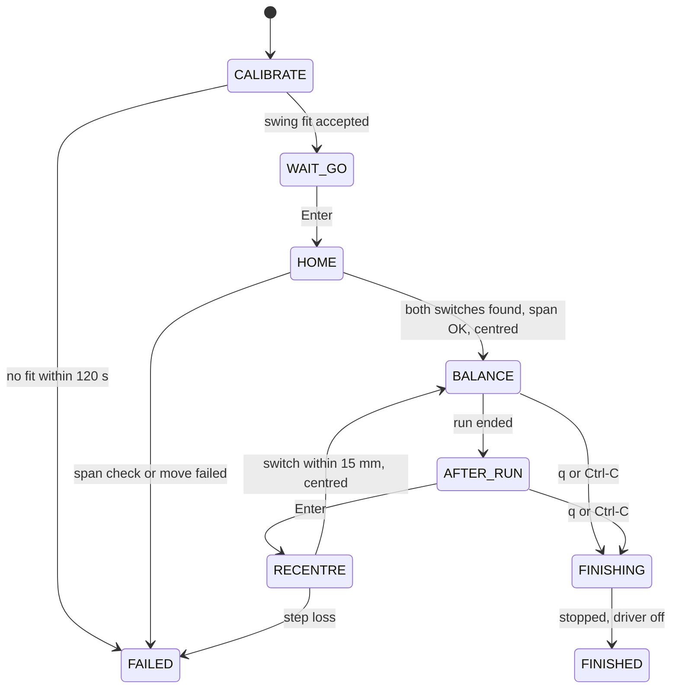
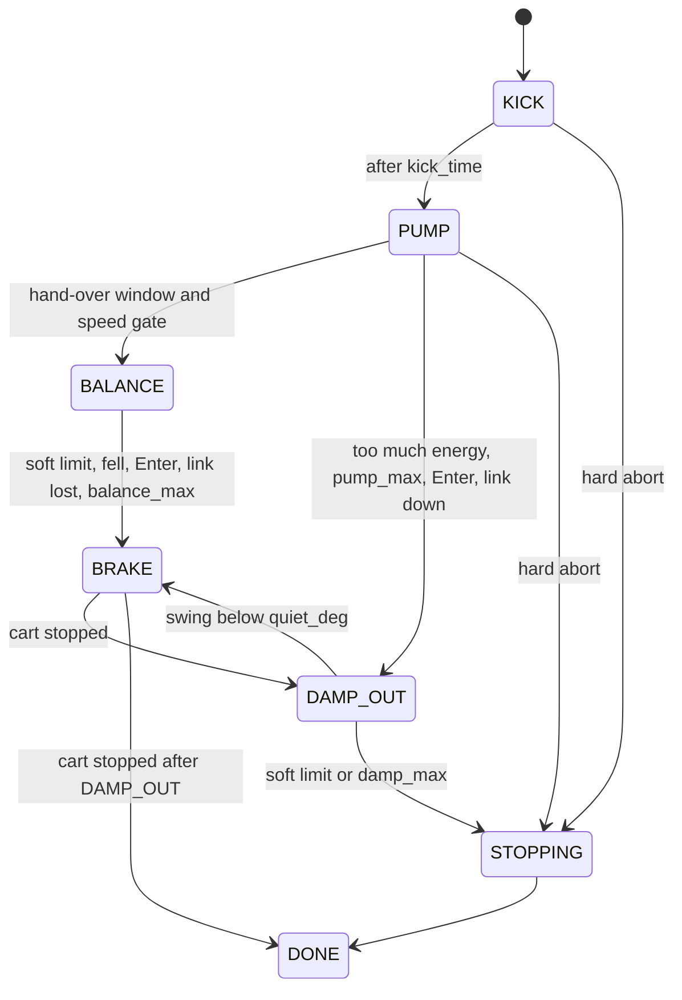
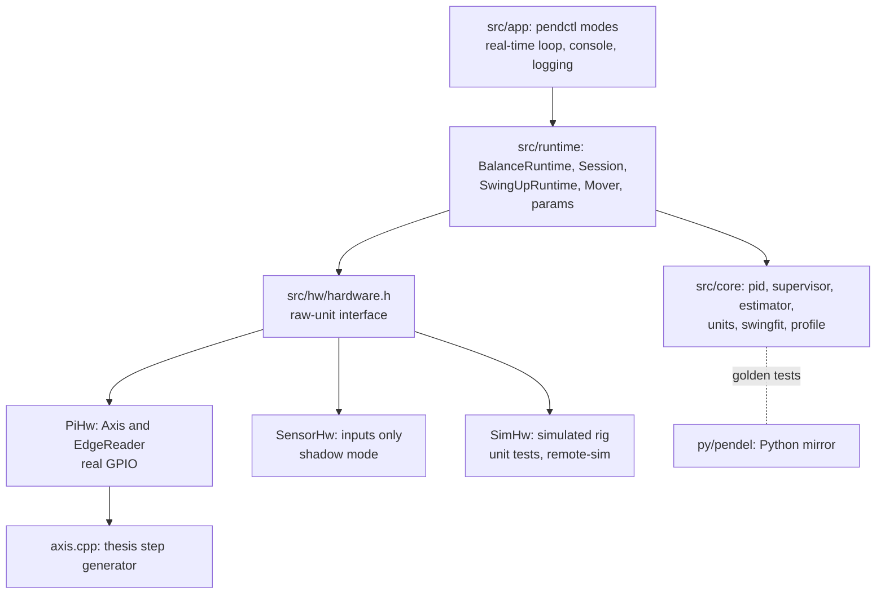
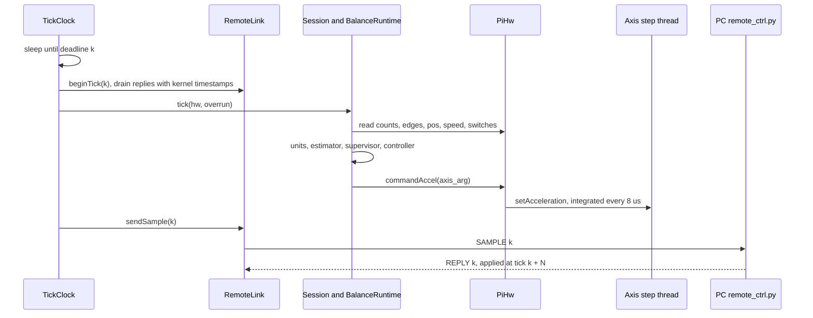
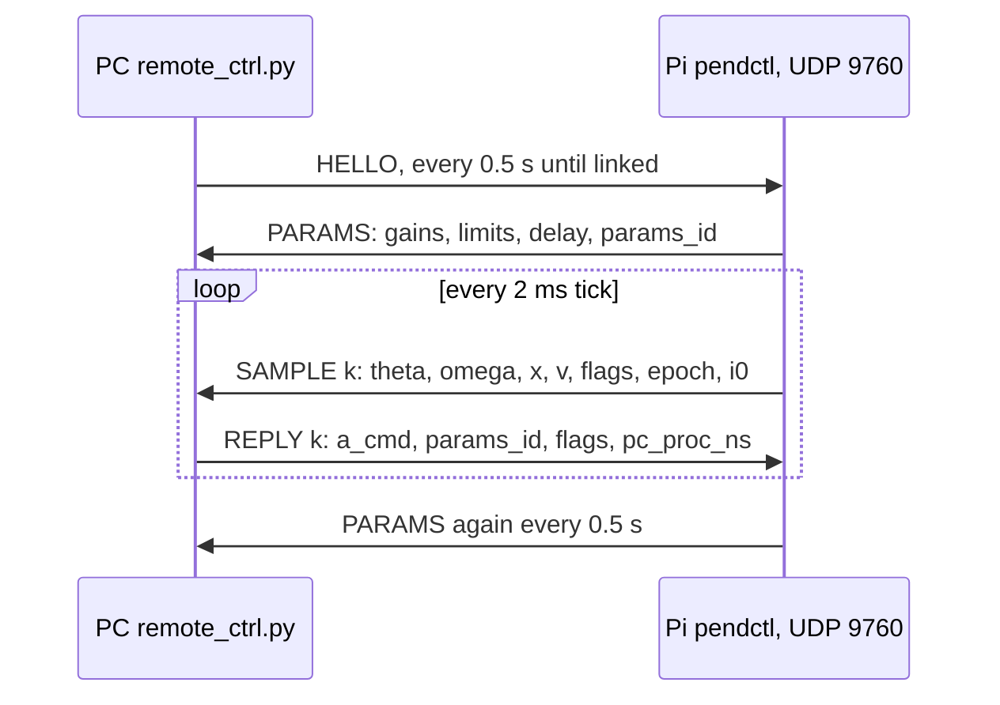

# Pendel: theory and technical reference

This is the background and reference document for the Pendel cart-pole rig: what the rig is, the physics, the
control theory, the hardware, and how the software is put together. It is written for a new student or lab
member who knows basic programming and calculus and has never seen this project.

- **How to install, connect and run things:** [`docs/02_setup_and_operation_guide.md`](02_setup_and_operation_guide.md).
- **Deeper, dated design notes** (derivations, measurements, decisions) stay in the other files in `docs/`. This
  document links to them where they add detail.

**What this describes.** Branch `control-dev` as committed on 2026-11-19; its controller code and settings are those
of commit `fad2469` (2026-11-04). Every number below comes from that code, from `config/pendctl.conf`, or from the
measurement documents in `docs/`. Where something is not in the repo, a callout says so:

> ⚠️ TODO / unverified: callouts like this one mark facts that are missing from the repo or not yet checked. Do
> not treat them as settled.

**Contents**

0. [Notation](#0-notation)
1. [System overview](#1-system-overview)
2. [Physics and modelling](#2-physics-and-modelling)
3. [Control theory](#3-control-theory)
4. [Hardware and electronics](#4-hardware-and-electronics)
5. [Software architecture](#5-software-architecture)
6. [Glossary and references](#6-glossary-and-references)

---

## 0. Notation

Symbols are defined once here and used the same way in both documents. The right-hand column gives the name the
code or the config file uses, so you can search for it.

| Symbol | Meaning | Unit | In code / config |
|---|---|---|---|
| $x$ | cart position, from the track centre; **+x points toward the LEFT limit switch** (seen from the rig's front) | m | `x`, `core::xFromPos` |
| $v=\dot x$ | cart velocity | m/s | `v`, `core::vFromAxisSpeed` |
| $a=\ddot x$ | cart acceleration: **the control input** | m/s² | `a_cmd` |
| $\theta$ | pendulum angle **from upright**, positive when the top leans toward +x | rad | `theta` |
| $\omega=\dot\theta$ | pendulum angular velocity (estimated, never measured directly) | rad/s | `omega` |
| $\varphi=\theta-\pi$ | angle from hanging (used near the bottom) | rad | `phi` |
| $\omega_0$ | small-angle natural frequency of the **hanging** pendulum | rad/s | `plant.w0` |
| $\beta=b/J$ | viscous pivot friction divided by the pendulum inertia | 1/s | `plant.bJ` |
| $\gamma_c$ | Coulomb (dry) pivot friction, as an angular acceleration | rad/s² | `plant.coulomb` |
| $g$ | gravitational acceleration, 9.81 | m/s² | `kGCascade`, `G` |
| $L_\text{eq}=g/\omega_0^2$ | length of the equivalent point-mass pendulum | m | |
| $n$ | encoder count (cumulative, 0 at program start) | counts | `counts` |
| CPR | encoder counts per revolution (2400) | counts | `encoder.counts_per_rev` |
| $q=2\pi/\text{CPR}$ | angle of one count (2.618 mrad = 0.15°) | rad | |
| $c_\text{bottom}$ | encoder position of the hanging equilibrium (fitted at every start) | counts | `c_bottom` |
| $T_s$ | control period, 2 ms (500 Hz) | s | `loop.ts`, `dt`, `ts` |
| $K_p, K_i, K_d$ | PID gains | (m/s²)/rad, (m/s²)/(rad·s), (m/s²)/(rad/s) | `kp`, `ki`, `kd` |
| $\omega_c,\ \zeta,\ p$ | pole-placement design: closed-loop bandwidth, damping, integral pole | rad/s, –, rad/s | `ctrl.wc_over_w0`·$\omega_0$, `ctrl.zeta`, `ctrl.p_over_w0`·$\omega_0$ |
| $e=\theta-\theta_\text{ref}$ | control error | rad | `e` |
| $I=\int e\,dt$ | integrator state | rad·s | `integral` |
| $\theta_\text{ref}$ | angle reference (set by the outer cart loop) | rad | `theta_ref` |
| $k_x, k_v, k_i$ | outer cart-loop gains | 1/s², 1/s, 1/s³ | `cart_kx`, `cart_kv`, `cart_ki` |
| $X=\int x\,dt$ | outer-loop integrator state | m·s | `x_int` |
| $a_\text{max},\ v_\text{max}$ | command saturation and cart speed limit | m/s², m/s | `a_max`, `v_max` (`balance.a_max`, `balance.v_max`) |
| $N$ | constant command delay in remote mode | ticks of $T_s$ | `remote.delay_ticks` |
| $\tau$ | total loop delay | s | |
| $E$ | pendulum energy per unit inertia (0 = upright at rest) | rad²/s² | `E`; normalised as `energy` |

Sign conventions were established physically on 2026-10-09 (`CLAUDE.md`, "Conventions"): `calib.x_sign = 1` and
`calib.theta_sign = 1`, i.e. increasing step count means +x, and increasing encoder count means increasing θ.

```
   LEFT switch (GPIO9)                                   RIGHT switch (GPIO2)
   pos high  |<========== +x (pos increasing) ==========|  pos low
             |<---------- ~0.45 m between switches ----->|
   (as you stand at the rig's front)
```

---

## 1. System overview

### 1.1 What the rig is

The rig is a **cart-pole**: a pendulum hangs from a pivot on a cart, and the cart runs on a linear rail. The task
is to keep the pendulum balanced upright by moving the cart, like balancing a broom on your palm.

| Part | What it is | Details |
|---|---|---|
| Cart and rail | 3D-printed cart on an MGN15 linear rail, on an 85 × 35 cm base board | belt-driven: GT2 belt, 60-tooth pulley = 120 mm of belt per motor turn |
| Actuator | NEMA 23 **stepper motor** (23HS2430) on an **A4988** driver at 24 V | 1/8 microstep, 13 333 microsteps per metre of cart travel |
| Pendulum | M3 threaded rod with nuts as the weight, screwed into a small pulley hub on the encoder shaft | ω₀ = 4.97 rad/s, i.e. it behaves like a 0.40 m point-mass pendulum |
| Angle sensor | incremental **quadrature encoder**, 600 pulses/rev | 2400 counts/rev; no index pulse, so the angle is relative |
| End stops | two normally-open limit switches near the track ends | used for homing, the step-loss audit and as an abort trigger |
| Computer | **Raspberry Pi 4** (host `pendel`, user `pendel`) on a custom carrier PCB | runs the 500 Hz control loop in C++ (`pendctl`) |
| Lab PC | Windows PC | development, analysis, and in remote mode the controller itself (`py/remote_ctrl.py`) |

Sources: `docs/thesis_notes.md`, `docs/parts_reference.md`, `docs/pcb_bringup.md`, `config/pendctl.conf`.

There is **no cart encoder**. The software knows the cart position only by counting the steps it sent. If the
motor ever loses steps, the position estimate is silently wrong. That is why the software touches a limit switch
after every run and compares where the switch closed with where the step count says it should be (the
"step-loss audit", §5.2).

### 1.2 What is measured and what is commanded

| | Signal | How | Notes |
|---|---|---|---|
| Measured | pendulum angle θ | encoder counts, every edge timestamped by the kernel | quantised to $q$ = 0.15°; relative (0 at program start) |
| Measured | limit switches | two GPIO inputs, 1 = free, 0 = pressed | only at the track ends |
| Known, not measured | cart position $x$ and speed $v$ | the Axis step generator's own step count and speed | open loop: lost steps are invisible |
| Estimated | angular velocity ω | filtered difference of encoder counts (§3.3) | |
| Commanded | cart acceleration $a$ | the step generator integrates it into a step rate | the stepper moves the cart kinematically |

### 1.3 Goal and operating modes

The goal is to balance the pendulum upright for as long as possible within the finite track, and to use the rig
to study how **latency** in the control loop affects stability. The controller exists in two placements:

- **Local mode** (`./demo.sh`): the whole loop runs on the Pi. The controller is a PID on the angle, cascaded
  with a slow outer loop on the cart position (§3.2–3.4).
- **Remote mode** (`./remote.sh` on the Pi plus `py/remote_ctrl.py` on the PC): the Pi streams every sample to
  the PC over UDP. The PC runs **the same controller** (a Python mirror that is tested bit-for-bit against the
  C++) and sends the command back. The Pi applies it exactly $N$ ticks after the sample it came from, a
  **constant delay** (§3.7). Everything safety-related stays on the Pi.

> **Note: the code is ahead of the original brief.** The brief's Stage 1 was "angle-only PID, no swing-up, no
> cart feedback". The code now also has: an energy-based **swing-up** (`./swingup.sh`, also with `--remote`), a
> **cascaded outer cart loop** with an integral (Stage 3/3b, on by default), **soft limits** with a braking
> distance, homing with a step-mode check, and the step-loss audit. §3.8 lists what is genuinely still to come.

Other programs and modes exist for bring-up and testing. They are listed in §5.2.

### 1.4 Block diagram

Hardware, the carrier PCB, the Pi, the network and the PC:



Data flow in the two modes. Only the box marked "controller" moves between the machines:



---

## 2. Physics and modelling

Full derivations, done three ways, are in `docs/eom_derivation.md` and `docs/model_derivation.md`. This section
derives the general cart-pole with Lagrange, then shows why this rig needs only the pendulum half of it.

### 2.1 Free-body diagrams

Drawn with +x to the right. On the rig, +x points toward the LEFT switch as seen from the front.

**Pendulum** (rod, nuts, hub: everything that rotates; mass $m$, centre of mass G at distance $l$ from the pivot,
inertia $J_c$ about G and $J=J_c+ml^2$ about the pivot):

```
             y
             ^             G  (centre of mass)
             |           o
             |          /|
             |     l   / |
             |        /  v  m*g          gravity, acting at G
             |       / θ                 θ from the vertical, + = top leans toward +x
             |      /
      -------+-----P----------------> x  P = pivot, on the cart
                   ^ V
               H --+                     (H, V) = force of the cart on the pendulum, at P
                   (turning) -b*θ'       bearing friction torque, plus Coulomb -J*γc*sign(θ')
```

**Cart** (mass $M$):

```
                     -V  v   <-- -H       reaction of the pendulum, at the pivot P
              +----------P-----------+
   F_belt --> |      cart, mass M     | <-- F_f   rail and belt friction, opposes x'
              +----------------------+
                   ^ N        v M*g
   =====================================  MGN15 rail
```

### 2.2 Lagrange equations of the general cart-pole

Take the cart position $x$ and the pendulum angle $\theta$ as generalised coordinates. The pivot is at
$(x, 0)$ and the centre of mass at

$$
x_G = x + l\sin\theta, \qquad y_G = l\cos\theta .
$$

Differentiating with the chain rule:

$$
\dot x_G = \dot x + l\dot\theta\cos\theta, \qquad \dot y_G = -l\dot\theta\sin\theta,
\qquad \dot x_G^2+\dot y_G^2 = \dot x^2 + 2l\dot x\dot\theta\cos\theta + l^2\dot\theta^2 .
$$

**Kinetic energy:** the cart's translation, the pendulum's translation of G, and its rotation about G:

$$
T = \tfrac12 M\dot x^2 + \tfrac12 m\left(\dot x_G^2+\dot y_G^2\right) + \tfrac12 J_c\dot\theta^2
  = \tfrac12 (M+m)\dot x^2 + m l\cos\theta\,\dot x\dot\theta + \tfrac12 J\dot\theta^2 ,
$$

where the parallel-axis theorem $J = J_c + ml^2$ appeared by itself.

**Potential energy** (height of G above the pivot): $V = m g l\cos\theta$. **Lagrangian:** $\mathcal L = T - V$.

**Generalised forces** (the non-conservative ones): the belt force minus friction on the cart, and the friction
torque at the pivot:

$$
Q_x = F - F_f, \qquad Q_\theta = -b\dot\theta - J\gamma_c\,\operatorname{sign}\dot\theta .
$$

**Euler–Lagrange for $x$,** $\dfrac{d}{dt}\dfrac{\partial\mathcal L}{\partial\dot x}-\dfrac{\partial\mathcal L}{\partial x}=Q_x$:

$$
\frac{\partial\mathcal L}{\partial\dot x} = (M+m)\dot x + ml\dot\theta\cos\theta,\qquad
\frac{d}{dt}\frac{\partial\mathcal L}{\partial\dot x} = (M+m)\ddot x + ml\ddot\theta\cos\theta - ml\dot\theta^2\sin\theta,\qquad
\frac{\partial\mathcal L}{\partial x} = 0,
$$

$$
\boxed{(M+m)\ddot x + ml\cos\theta\,\ddot\theta - ml\sin\theta\,\dot\theta^2 = F - F_f} \tag{1}
$$

**Euler–Lagrange for $\theta$:**

$$
\frac{\partial\mathcal L}{\partial\dot\theta} = ml\dot x\cos\theta + J\dot\theta,\qquad
\frac{d}{dt}\frac{\partial\mathcal L}{\partial\dot\theta} = ml\ddot x\cos\theta - ml\dot x\dot\theta\sin\theta + J\ddot\theta,\qquad
\frac{\partial\mathcal L}{\partial\theta} = -ml\dot x\dot\theta\sin\theta + mgl\sin\theta .
$$

The $\dot x\dot\theta$ terms cancel (a constant cart velocity has no effect), leaving

$$
\boxed{J\ddot\theta = mgl\sin\theta - ml\cos\theta\,\ddot x - b\dot\theta - J\gamma_c\operatorname{sign}\dot\theta} \tag{2}
$$

In matrix form, $M(q)\ddot q = f(q,\dot q, F)$:

$$
\begin{bmatrix} M+m & ml\cos\theta \\ ml\cos\theta & J \end{bmatrix}
\begin{bmatrix} \ddot x \\ \ddot\theta \end{bmatrix}
=
\begin{bmatrix} F - F_f + ml\dot\theta^2\sin\theta \\ mgl\sin\theta - b\dot\theta - J\gamma_c\operatorname{sign}\dot\theta \end{bmatrix}
$$

The mass matrix has determinant $(M+m)J - m^2l^2\cos^2\theta > 0$, so it can always be solved for $\ddot x$ and
$\ddot\theta$. This is the textbook cart-pole driven by a **force** $F$.

### 2.3 Why this rig only needs equation (2)

A stepper motor does not apply a chosen force; it imposes a **position**, step by step. As long as it does not
lose steps, the cart's motion $x(t)$ is whatever the software commands, and the motor supplies whatever force
equation (1) demands (up to its torque limit). So the input is the cart acceleration $a = \ddot x$, and equation
(1) no longer constrains the motion. It only says how much force the motor must deliver:

$$
F = (M+m)\,a + ml\left(\ddot\theta\cos\theta - \dot\theta^2\sin\theta\right) + F_f .
$$

That force matters for step loss, not for the model. Dividing equation (2) by $J$ and naming the groups:

$$
\omega_0^2 = \frac{mgl}{J},\qquad \frac{ml}{J} = \frac{\omega_0^2}{g},\qquad \beta = \frac{b}{J}
$$

$$
\boxed{\ddot\theta = \omega_0^2\sin\theta - \frac{\omega_0^2}{g}\,a\cos\theta - \beta\dot\theta - \gamma_c\operatorname{sign}\dot\theta} \tag{3}
$$

The masses, lengths and inertias enter **only** through $\omega_0$ and $\beta$, and both can be measured from a
free swing of the hanging pendulum (§2.5). The cart mass $M$ and the belt drop out entirely. This is the model the
code uses everywhere: `py/pendel/plant.py:37-43` (simulation), `src/hw/sim_hw.h` (C++ simulation), and the gain
design (`src/core/pid.cpp:100-105`). Its validity was checked on the rig: the input gain $\omega_0^2/g$ came out
at 93 % of the model in a pulse test and 103 % in the hanging damping test (`docs/gateB_report.md` §1).

**Steady lean.** Setting $\ddot\theta=\dot\theta=0$ in (3) gives $a = g\tan\theta \approx g\theta$: to hold the
pendulum at a constant lean, the cart must accelerate steadily toward the lean. This one fact explains both the
cart drift of a slightly wrong upright reference (§3.2) and how the outer cart loop works (§3.4).

**Hanging.** With $\theta = \pi + \varphi$, (3) becomes a damped oscillator,
$\ddot\varphi + \beta\dot\varphi + \omega_0^2\varphi = +\frac{\omega_0^2}{g}a$, with period $T_0 = 2\pi/\omega_0$.
The input enters with the **opposite sign** to upright. The hanging damping test (`--mode damp`) uses this.

### 2.4 Linearisation about upright and the state-space model

**Acceleration-input model (what the code uses).** State $s = [x,\ v,\ \theta,\ \omega]^T$, input $u = a$. The
upright equilibrium is $\theta = \omega = 0$, $a = 0$, any $x$, $v = 0$. Near it, $\sin\theta \approx \theta$,
$\cos\theta \approx 1$, and the Coulomb term is dropped (it is not differentiable at $\omega = 0$; it shows up as a
small dead band, §2.5). The Jacobians of (3) at the equilibrium give

$$
\dot s = A s + B u,\qquad
A = \begin{bmatrix} 0 & 1 & 0 & 0 \\ 0 & 0 & 0 & 0 \\ 0 & 0 & 0 & 1 \\ 0 & 0 & \omega_0^2 & -\beta \end{bmatrix},\qquad
B = \begin{bmatrix} 0 \\ 1 \\ 0 \\ -\omega_0^2/g \end{bmatrix}.
$$

With the current parameters, $\omega_0^2 = 24.70\ \text{s}^{-2}$, $\beta = 0.054\ \text{s}^{-1}$ and
$\omega_0^2/g = 2.518\ \text{m}^{-1}$.

**Outputs.** Only one state is physically sensed: θ, by the encoder. The cart states come from the step generator's
own bookkeeping.

$$
y_\text{sensed} = C_\text{s}\, s,\quad C_\text{s} = \begin{bmatrix} 0 & 0 & 1 & 0 \end{bmatrix};\qquad
y_\text{available} = C_\text{a}\, s,\quad C_\text{a} = \begin{bmatrix} 1&0&0&0\\0&1&0&0\\0&0&1&0 \end{bmatrix};\qquad D = 0 .
$$

- θ is measured, quantised to $q$ = 2.618 mrad.
- $x$ and $v$ are *known* from the step count and the commanded step rate (`src/core/units.cpp:24-30`), not
  measured.
- ω is never measured; it is estimated from the counts (§3.3).
- With the encoder alone, $x$ and $v$ are **unobservable**: in (3) the pendulum does not depend on where the cart
  is or how fast it moves, only on its acceleration. The controller knows the cart state only because it counts
  its own steps.

**Transfer functions.** From the input to the angle, and from the input to the cart position:

$$
G_\theta(s) = \frac{\Theta(s)}{A(s)} = \frac{-\omega_0^2/g}{s^2 + \beta s - \omega_0^2},\qquad
G_x(s) = \frac{X(s)}{A(s)} = \frac{1}{s^2}.
$$

**Force-input model (for completeness).** Linearising (1)–(2) instead, with a viscous cart friction
$F_f = c\dot x$ and $D_0 = (M+m)J - m^2l^2$:

$$
A_F = \begin{bmatrix}
0 & 1 & 0 & 0\\
0 & -\dfrac{Jc}{D_0} & -\dfrac{m^2l^2g}{D_0} & \dfrac{mlb}{D_0}\\
0 & 0 & 0 & 1\\
0 & \dfrac{mlc}{D_0} & \dfrac{(M+m)mgl}{D_0} & -\dfrac{(M+m)b}{D_0}
\end{bmatrix},\qquad
B_F = \begin{bmatrix} 0\\ \dfrac{J}{D_0}\\ 0\\ -\dfrac{ml}{D_0} \end{bmatrix}.
$$

This model needs $M$, $m$, $l$, $J$ and $c$, none of which is known (§2.5). It would matter for a DC-motor or
force-controlled cart; with a stepper that does not lose steps, the acceleration model above is exact.

### 2.5 Parameters

"Measured" means measured on this rig and recorded in the repo; "prior" means taken from the thesis or a datasheet
and not yet checked; "derived" means computed from measured values.

| Quantity | Value | Status | Source |
|---|---|---|---|
| $\omega_0$ (`plant.w0`) | 4.97 rad/s ($T_0$ = 1.264 s) | measured 2026-11-02 (free decay after the support-bearing fix) | `config/pendctl.conf:62`, `CLAUDE.md` Status |
| $\beta = b/J$ (`plant.bJ`) | 0.054 1/s | measured (envelope fit, same recording) | `config/pendctl.conf:63` |
| $\gamma_c$ (`plant.coulomb`) | 0.168 rad/s² (stiction band about ±2.6 counts) | measured, same recording | `config/pendctl.conf:64` |
| Same three, old pivot | 4.931 rad/s, 0.024 1/s, 0.0117 rad/s² | measured 2026-10-09, superseded | `docs/stage0_6_7_10_results.md` |
| $L_\text{eq} = g/\omega_0^2$ | 0.397 m | derived | |
| Input gain $\omega_0^2/g$ | 2.518 1/m | derived; the old pivot's pulse and damping tests gave 93 % and 103 % of the model | `docs/gateB_report.md` §1 |
| $g$ | 9.81 m/s² | constant in the code | `src/core/pid.h:62`, `src/core/pid.h:82` |
| CPR | 2400 counts/rev | measured exact (5 turns = 12 000.5 counts) | `config/pendctl.conf:6` |
| Cart scale | 13 333 µsteps/m (75 µm per µstep) | prior (GT2, 60 teeth, 1/8 step), checked with a ruler (307 steps ≈ 23 mm) | `config/pendctl.conf:14` |
| STEP toggles per µstep | 2 | measured 1.9985 | `config/pendctl.conf:17`, `docs/gateB_report.md` |
| Switch-to-switch span | config 6104 µsteps (0.458 m); measured 5938–5939 µsteps (0.445 m) since the 2026-11-02 rebuild | measured | `config/pendctl.conf:205`, `logs/2026-11-04T10-16-08_balance/meta.json` |
| Motor (23HS2430) | 1.8°/step, 3 A rated, 280 N·cm holding torque, 800 g·cm² rotor | datasheet (prior) | `docs/parts_reference.md` §3 |
| Pendulum mass $m$, COM distance $l$, inertia $J$ | — | **unknown** | |
| Cart mass $M$, cart friction $c$ | — | **unknown** | |

> ⚠️ TODO / unverified: the repo records no pendulum mass, length or inertia, and no cart mass
> (`docs/thesis_notes.md`: "no length/mass given"; `docs/parts_reference.md` §5 lists what to measure). The
> acceleration model does not need them, but a force or torque budget (step-loss limits) and any force-input model
> would.

> ⚠️ TODO / unverified: the switch span in the config (6104 µsteps) is still the old carriage's. The rig has
> measured 5938–5939 µsteps since 2026-11-02, which passes the ±5 % homing check but has not been written back
> (`docs/stage1_demo.md`, "After a mechanical rebuild", step 5).

**Coulomb friction.** Since the 2026-11-02 support bearing, dry friction dominates the pivot (14× the old value).
It does not change the linear analysis, but it creates a stiction band of a few counts around any rest position.
That matters for the start-up calibration (a small swing dies within the fit window, so the calibration now asks
for a ~20° swing) and for `remote-sim`, whose simulated rod sticks at upright with this value (§5.2).

### 2.6 Why upright is unstable

**Intuition.** If the top leans a little toward +x, gravity's torque about the pivot pulls it further toward +x,
and the further it leans, the harder gravity pulls. Nothing restores it. Accelerating the cart toward +x moves the
pivot under the centre of mass and tips it back. That is why every gain in this controller is positive:
**lean toward +x → accelerate toward +x**.

**Mathematically.** The characteristic polynomial of $A$ is

$$
\det(sI - A) = s^2\left(s^2 + \beta s - \omega_0^2\right),
$$

with roots

$$
s_{1,2} = 0,\ 0 \qquad s_{3,4} = -\frac{\beta}{2} \pm \sqrt{\frac{\beta^2}{4} + \omega_0^2} = +4.943\ \text{s}^{-1},\ -4.997\ \text{s}^{-1}.
$$

- **One pole in the right half-plane, at $s \approx +\omega_0$.** An uncorrected tilt grows like
  $e^{4.94\,t}$: by a factor $e$ every 0.20 s, doubling every 0.14 s. That is the time scale the controller must
  beat, and it sets every timing budget in this project.
- **The mirror pole at $\approx -\omega_0$** is the stable direction: a pendulum coasting toward upright with
  exactly the right speed approaches along $\dot\theta = -\omega_0\theta$. The swing-up hand-over uses this
  (§3.8).
- **A double pole at 0: the cart.** It is a pure double integrator. Any velocity persists and any constant
  acceleration integrates into position, so without feedback on $x$ the cart drifts until it runs out of track.
  This is why the outer cart loop exists (§3.4).

Compare the hanging pendulum: poles at $-\beta/2 \pm j\sqrt{\omega_0^2 - \beta^2/4}$, a lightly damped stable
oscillation with damping ratio $\beta/(2\omega_0) \approx 0.005$ (plus the dry friction).

The system is **controllable** from $a$: the controllability matrix $[B\ AB\ A^2B\ A^3B]$ has determinant
$\pm(\omega_0^2/g)^2\omega_0^4 \neq 0$. Every state, including the cart's, can be steered with the one input.

---

## 3. Control theory

### 3.1 The control structure in the code

Every tick (2 ms), `rt::BalanceRuntime::tick` (`src/runtime/balance.cpp:88-193`) does:



The pieces, in the order this section explains them:

| Piece | Code | Section |
|---|---|---|
| Inner loop: PID on the angle | `core::pidStep`, `src/core/pid.cpp:19-55` | 3.2, 3.3 |
| Velocity estimator | `core::VelocityEstimator`, `src/core/estimator.cpp` | 3.3 |
| Outer loop: cart position and speed set the angle reference | `core::cartThetaRef`, `core::cascadeStep`, `src/core/pid.cpp:57-80` | 3.4 |
| Supervisor: when the controller may act, and every abort | `core::supervisorStep`, `src/core/supervisor.cpp` | 3.5 |
| Swing-up (separate runtime) | `rt::SwingUpRuntime`, `src/runtime/swingup.cpp` | 3.8 |

All controller code is **pure**: parameters, state and measurement go in; command and new state come out. There is
no I/O and no clock. The same functions therefore run on the Pi, in simulation on the PC, and (through a Python
mirror, `py/pendel/control.py`) in the remote PC program. Golden tests check that C++ and Python agree to the
last bit (`tests/golden/`, `py/make_golden.py`).

### 3.2 PID: what each term does, and the gain design

The controller computes

$$
a = K_p\,e + K_i\!\int e\,dt + K_d\,\omega,\qquad e = \theta - \theta_\text{ref}.
$$

- **P** pushes the cart under the pendulum in proportion to the tilt. It has to **beat gravity**: substituting
  $a = K_p\theta$ into the linear model gives $\ddot\theta = (\omega_0^2 - K_p\omega_0^2/g)\,\theta + \dots$, which
  only restores if $K_p > g$ (in (m/s²)/rad). Below that the cart cannot accelerate hard enough to get under the
  pendulum.
- **D** reacts to the angular velocity and adds damping. Without it the loop would oscillate.
- **I** integrates the error. It removes a steady angle error, and it acts as **hidden cart-velocity feedback**:
  integrating the linear model once shows that $C = (g/\omega_0^2)\,\dot\theta + \dot x - g\int\theta\,dt$ is
  conserved whatever the controller does (no friction). Since the integrator drives $\int\theta\,dt \to 0$, the
  cart returns to its velocity at engage (`docs/model_derivation.md` §7). A PD controller keeps
  $g\int\theta\,dt$ from the catch as residual cart velocity.

Note that D is applied to the **measurement** ω, not to the error. A sudden change of $\theta_\text{ref}$ (from the
outer loop) therefore causes no derivative kick.

**Closed loop.** Put $a = K_p\theta + K_i I + K_d\dot\theta$ (with $\theta_\text{ref}=0$, $\dot I = \theta$) into
the linear pendulum equation and write $k = \omega_0^2/g$:

$$
s^3 + (\beta + kK_d)\,s^2 + (kK_p - \omega_0^2)\,s + kK_i = 0 .
$$

Routh–Hurwitz needs all coefficients positive ($K_p > g$, $K_i > 0$) and $(\beta + kK_d)(kK_p-\omega_0^2) > kK_i$.
There is no *upper* limit on the gains in this ideal model; the upper limits come from sampling, delay and the
velocity filter (§3.6–3.7).

**Pole placement.** Choose the closed-loop poles as a damped pair at $\omega_c$ with damping $\zeta$, plus a real
pole at $p$, and match coefficients:

$$
(s^2 + 2\zeta\omega_c s + \omega_c^2)(s+p) = s^3 + (2\zeta\omega_c + p)s^2 + (\omega_c^2 + 2\zeta\omega_c p)s + \omega_c^2 p
$$

$$
K_p = g\left(1 + \frac{\omega_c^2 + 2\zeta\omega_c p}{\omega_0^2}\right),\qquad
K_d = \frac{(2\zeta\omega_c + p - \beta)\,g}{\omega_0^2},\qquad
K_i = \frac{g\,\omega_c^2\,p}{\omega_0^2}\quad (p = 0 \text{ gives PD}).
$$

This is `core::designGains` (`src/core/pid.cpp:100-105`), called from `rt::balanceFrom`
(`src/runtime/params.cpp:58-63`). The gains are **not** in the config file; they are recomputed at every start
from `plant.w0`, `plant.bJ` and the three design ratios:

| Design input | Config | Value |
|---|---|---|
| $\omega_c / \omega_0$ | `ctrl.wc_over_w0` (`config/pendctl.conf:119`) | 2.0 → $\omega_c$ = 9.94 rad/s |
| $\zeta$ | `ctrl.zeta` (`config/pendctl.conf:120`) | 0.7 |
| $p / \omega_0$ | `ctrl.p_over_w0` (`config/pendctl.conf:121`) | 0.5 → $p$ = 2.485 rad/s |

| Result | Value | Meaning |
|---|---|---|
| $K_p$ | **62.78** (m/s²)/rad $= 6.4\,g$ | 1.10 m/s² per degree, 0.164 m/s² per encoder count |
| $K_i$ | **97.51** (m/s²)/(rad·s) $= 2g\omega_0$ | |
| $K_d$ | **6.492** (m/s²)/(rad/s) | one count step adds $K_d\,q$ ≈ 17 mm/s to the cart speed |
| Closed-loop poles | $-6.96 \pm 7.10j$, $-2.49$ rad/s | |

These are exactly the values the rig printed on 2026-11-04 (`logs/2026-11-04T10-16-08_balance/meta.json`: kp
62.7840, ki 97.5114, kd 6.4922). `tests/unit/test_params.cpp:21-25` checks $K_p = 6.4g$ and $K_i$ against the
config. Why these choices: $\omega_c = 2\omega_0$ trades disturbance rejection against noise and delay tolerance,
and $\zeta = 0.7$ minimised the peak sensitivity (`docs/gateB_report.md` §4 and its appendix, `py/zeta_sweep.py`).

**Reference offset → drift.** If the controller's idea of upright is off by δ, the only steady state with $e = 0$
is a pendulum leaning by δ, which needs $a = g\delta$ (§2.3). One count of error, $q$ = 2.618 mrad, is
25.7 mm/s² of steady cart acceleration: 0.15 m in 3.4 s. That is why the upright reference is calibrated to a
fraction of a count at every start (§4.1), with a trim (`encoder.trim`), and why the outer loop needs an integral
(§3.4).

### 3.3 The discrete-time implementation

#### The PID step

This is the complete inner controller, `src/core/pid.cpp:19-55`:

```cpp
PidResult pidStep(const PidParams& p, const PidState& s, double theta, double v_cart, double dt,
                  const double* velEst) {
    // Derivative of the measurement (not of the error), filtered.
    const double vel_raw = s.has_prev ? (theta - s.prev_theta) / dt : 0.0;
    const double alpha = dt / (dt + 1.0 / (2.0 * kPi * p.vel_fc));
    const double vel_f = velEst ? *velEst : s.vel_f + alpha * (vel_raw - s.vel_f);

    const double e = theta - p.theta_ref;
    const double u = p.kp * e + p.ki * s.integral + p.kd * vel_f;

    // Saturation with authority taper near +-v_max: no more acceleration toward the limit.
    const double w = p.v_taper * p.v_max;
    const double a_hi = p.a_max * taper(p.v_max - v_cart, w);
    const double a_lo = -p.a_max * taper(p.v_max + v_cart, w);
    const double a_cmd = std::min(a_hi, std::max(a_lo, u));
    const bool saturated = a_cmd != u;

    // Conditional integration: hold the integrator while it would push further into saturation,
    // and during the enable delay. Clamp its contribution.
    double integral = s.integral;
    if (s.t_engaged >= p.i_delay && p.ki != 0.0) {
        const bool pushes_out = saturated && (e * (u - a_cmd) > 0);
        if (!pushes_out) integral += e * dt;
        if (p.i_max > 0) {
            const double lim = p.i_max / std::fabs(p.ki);
            integral = std::min(lim, std::max(-lim, integral));
        }
    }

    PidState next;
    next.integral = integral;
    next.t_engaged = s.t_engaged + dt;
    next.vel_f = vel_f;
    next.prev_theta = theta;
    next.has_prev = true;
    return PidResult{a_cmd, next, u, e, vel_raw, saturated};
}
```

Line by line, with $k$ the sample index:

| Lines | What it does |
|---|---|
| 19–20 | Inputs: parameters `p`, the previous state `s`, the measured angle θ (rad, unwrapped), the cart speed $v$ (only for the speed taper), $T_s$, and optionally an external velocity estimate. Nothing else: no clock, no I/O. |
| 22 | Backward difference $\omega_{\text{raw},k} = (\theta_k - \theta_{k-1})/T_s$, zero on the first sample. |
| 23–24 | Built-in first-order low-pass $\omega_{f,k} = \omega_{f,k-1} + \alpha(\omega_{\text{raw},k} - \omega_{f,k-1})$, $\alpha = T_s/(T_s + 1/(2\pi f_c))$. **On the rig this is bypassed:** the runtime always passes its own estimate (`velEst`, below), so `vel_fc` has no effect there. |
| 26 | Error $e_k = \theta_k - \theta_\text{ref}$. |
| 27 | Unsaturated output $u_k = K_p e_k + K_i I_k + K_d\,\hat\omega_k$. $I_k$ is the integral **before** this sample, so $u_k$ uses $\sum_{j<k} e_j T_s$ (explicit rectangle rule). |
| 30–32 | Speed taper. With $w = v_\text{taper}\,v_\text{max}$ (= 0.075 m/s in balance mode), the allowed acceleration toward $+v_\text{max}$ falls linearly to 0 over the last $w$ before $v_\text{max}$ (`taper`, lines 12–15). Braking away from the limit is never reduced. |
| 33–34 | Output saturation: $a_k = \min(a_\text{hi}, \max(a_\text{lo}, u_k))$, and a flag if it clipped. |
| 38–41 | **Anti-windup by conditional integration.** $I_{k+1} = I_k + e_k T_s$, except while saturated *and* integrating would push $u$ further past the limit ($e_k(u_k - a_k) > 0$). Also held during the optional enable delay `i_delay` (0 by default: every bit of $\int\theta$ the integrator misses becomes cart velocity, `docs/stage1_drift.md`). |
| 42–44 | Clamp: $\lvert K_i I\rvert \le i_\text{max}$ = 1 m/s². |
| 48–54 | The new state is returned, never stored: the caller owns it. Resetting the controller means replacing the state with `PidState{}`. |

**When the state is reset.** At every engage, `BalanceRuntime` resets the PID state and the delay line
(`src/runtime/balance.cpp:146-159`). Optionally it pre-loads the integrator with $\dot\theta/\omega_0^2$, which
cancels the pendulum's momentum in the drift identity above. For hand catches this needs `sup.engage_on_release`,
which is off, so `ctrl.preload = true` currently has no effect there. The swing-up hand-over pre-loads whenever
`swingup.preload = true`, the default (`src/runtime/swingup.cpp:113-122`).

#### Units at the boundary

The controller works in SI units. Conversions happen only at the hardware boundary (`src/core/units.cpp`):

$$
\theta = \operatorname{wrap}\!\left(s_\theta\,\frac{2\pi}{\text{CPR}}\left(n + \tfrac12 - c_\text{bottom} - \tfrac{\text{CPR}}{2}\right)\right)
\quad\text{into } (-\pi, \pi]
\qquad (\text{lines } 17\text{–}20)
$$

- The $+\tfrac12$ uses the centre of the count interval: a count $n$ means the shaft is somewhere in $[n, n+1)$.
- $c_\text{bottom} + \text{CPR}/2$ is upright, because hanging and upright are exactly half a turn apart whatever
  the pendulum's shape.
- `encoder.trim` is added to the fitted $c_\text{bottom}$ (`src/runtime/session.cpp:242`); the controller's
  `theta_ref` stays 0 (`src/runtime/params.cpp:69`).

Cart: $x = s_x\,(\text{pos} - \text{pos}_\text{center})/13333$ and $v = s_x\,(-\text{curSpeed})/(2\cdot 13333)$
(lines 24–30). The command goes back as `axisAccelArg` $= \operatorname{round}(-s_x\,a \cdot 13333 \cdot 2)$
toggles/s² (lines 32–34). The minus sign and the factor 2 are properties of the step generator (§4.2).

#### The velocity estimator (the D term's input)

The encoder only gives counts. A backward difference jumps by $q/T_s$ = 1.3 rad/s whenever one count changes,
which through $K_d$ would be an 8.5 m/s² spike. The runtime therefore uses `core::VelocityEstimator` with
`ctrl.estimator = bdlp2`: a backward difference on the counts followed by a **2nd-order Butterworth low-pass**,
discretised with the bilinear transform and frequency pre-warping (`src/core/estimator.cpp:10-19`):

```cpp
VelocityEstimator::VelocityEstimator(Kind kind, double ts, double fc) : kind_(kind), ts_(ts) {
    alpha_ = ts / (ts + 1.0 / (2 * kPi * fc));
    const double k = std::tan(kPi * fc * ts);
    const double n = 1 / (1 + std::sqrt(2.0) * k + k * k);
    b0_ = k * k * n;
    b1_ = 2 * b0_;
    b2_ = b0_;
    a1_ = 2 * (k * k - 1) * n;
    a2_ = (1 - std::sqrt(2.0) * k + k * k) * n;
}
```

and per sample (`src/core/estimator.cpp:26-38`):

$$
x_k = \frac{n_k - n_{k-1}}{T_s},\qquad
y_k = b_0x_k + b_1x_{k-1} + b_2x_{k-2} - a_1y_{k-1} - a_2y_{k-2},\qquad
\hat\omega_k = y_k\cdot s_\theta\frac{2\pi}{\text{CPR}} .
$$

- **Cut-off** `ctrl.est_fc` = 14 Hz (`config/pendctl.conf:130`). It was 20 Hz until a ~28 Hz drive-side
  oscillation grew in 3 of 17 rig runs; 14 Hz cut the loop gain at 28 Hz by 45 % for 4° of phase margin
  (`docs/stage1_demo.md`, "Tap test and the velocity-filter trade").
- **Lag.** The filter delays slow signals by its group delay $\sqrt2/(2\pi f_c)$ ≈ 16 ms, plus half a sample from
  the backward difference. That lag, not the sampling, is the largest phase loss in the D path.
- **Why this one.** It was chosen on real recordings against a first-order filter, an α-β filter and an
  edge-timestamp estimator (`docs/stage0_11_estimators.md`).

The PID output is computed in `BalanceRuntime::tick` as
`core::cascadeStep(c_.pid, pid_, r.theta, r.x, r.v, c_.ts, &r.omega)` (`src/runtime/balance.cpp:162`); the last
argument is this estimate.

#### Output saturation

In balance mode (`./demo.sh`, `./remote.sh`, `./swingup.sh`) the limits are `balance.a_max` = 2.0 m/s² and
`balance.v_max` = 0.3 m/s (`config/pendctl.conf:198-199`). They replace `ctrl.a_max`/`ctrl.v_max` (3.0/0.5, used
only by the sensors-only shadow mode) in `rt::sessionFrom` (`src/runtime/params.cpp:146-152`).

> ⚠️ TODO / unverified: Stage 0.9 (actuator capability: reliable maximum acceleration and speed, step-loss limits,
> effective actuator delay) is still open (`CLAUDE.md`; `docs/gateB_report.md` marks it PENDING). The limits of
> 2 m/s² and 0.3 m/s are deliberately reduced first-catch values, not 50–70 % of measured maxima as the brief
> intends.

### 3.4 The outer cart loop (cascade, Stage 3/3b)

Angle-only control cannot hold the cart: the cart is a double integrator (§2.6), and any reference error drives it
at $g\delta$. The outer loop closes this by **choosing the lean**. Holding a lean θ takes a cart acceleration
$g\theta$ (§2.3), so to make the cart accelerate by $a_d$, ask the inner loop for the lean $a_d/g$
(`src/core/pid.cpp:57-80`):

```cpp
double cartThetaRef(const PidParams& p, double x_cart, double v_cart, double x_int, bool* clamped) {
    if (clamped) *clamped = false;
    if (p.cart_kx == 0.0 && p.cart_kv == 0.0 && p.cart_ki == 0.0) return 0.0;
    const double raw = (-p.cart_kx * x_cart - p.cart_kv * v_cart - p.cart_ki * x_int) / kGCascade;
    const double ref = std::min(p.cart_theta_max, std::max(-p.cart_theta_max, raw));
    if (clamped) *clamped = ref != raw;
    return ref;
}

PidResult cascadeStep(const PidParams& p, const PidState& s, double theta, double x_cart, double v_cart,
                      double dt, const double* velEst) {
    bool clamped = false;
    PidParams q = p;
    q.theta_ref = p.theta_ref + cartThetaRef(p, x_cart, v_cart, s.x_int, &clamped);
    PidResult r = pidStep(q, s, theta, v_cart, dt, velEst);
    double x_int = s.x_int;
    if (p.cart_ki != 0.0 && !clamped) {
        x_int += x_cart * dt;
        const double lim = kGCascade * p.cart_i_max / p.cart_ki;
        x_int = std::min(lim, std::max(-lim, x_int));
    }
    r.state.x_int = x_int;
    return r;
}
```

$$
a_d = -k_x x - k_v v - k_i X,\qquad X = \int x\,dt,\qquad
\theta_\text{ref} = \operatorname{clamp}\!\left(\frac{a_d}{g},\ \pm\theta_{\text{ref},\max}\right)
$$

Well below the inner loop's bandwidth the inner loop makes $\theta \approx \theta_\text{ref}$, so
$\ddot x \approx a_d$ and the cart obeys

$$
s^3 + k_v s^2 + k_x s + k_i = 0 \overset{!}{=} (s^2 + 2\zeta_x\omega_x s + \omega_x^2)(s + p_x),
$$

giving $k_v = 2\zeta_x\omega_x + p_x$, $k_x = \omega_x^2 + 2\zeta_x\omega_x p_x$, $k_i = \omega_x^2 p_x$. With
$\omega_x$ = 0.5 rad/s, $\zeta_x$ = 0.8, $p_x$ = 0.2 rad/s this is the configured
$k_x$ = 0.41 1/s², $k_v$ = 1.0 1/s, $k_i$ = 0.05 1/s³ (`config/pendctl.conf:142-146`), with the lean clamped to
±4° and the integral's share to ±2°.

**Why it must be slow.** Eliminating $a = \ddot x$ from the linear pendulum equation gives the map from lean to
cart position:

$$
\frac{X(s)}{\Theta(s)} = -\frac{g}{\omega_0^2}\,\frac{s^2 - \omega_0^2}{s^2}.
$$

It has a zero at $s = +\omega_0$ in the right half-plane: a **non-minimum-phase** zero. Physically, to accelerate
the cart toward −x the pendulum must first lean toward −x, which needs a step toward +x first. A loop cannot be
much faster than its right-half-plane zero, so the outer loop runs at $\omega_x$ = 0.5 rad/s, far below both
$\omega_0$ ≈ 5 rad/s and the inner crossover (~19 rad/s). Faster outer loops swayed in simulation
(`docs/stage3_cascade.md`).

**Why the integral (Stage 3b).** A proportional outer loop parks the cart where $k_x x = g\delta$, i.e. 0.13 m
off-centre for a 1.3-count reference error, which is where every Stage 3 run on 2026-11-04 ended. The integral
removes that offset. Its anti-windup mirrors the inner one: $X$ only integrates while the lean is inside its
clamp, and $\lvert k_i X\rvert/g \le$ `cart_i_max`. $X$ is reset at every catch, on the Pi and the PC alike.

With all three cart gains at 0, `cascadeStep` is exactly `pidStep` (the Stage 1 angle-only controller). That
equivalence is a unit test (`docs/stage3_cascade.md`, "Tests").

### 3.5 The supervisor

A small state machine (`src/core/supervisor.cpp`, mirrored in `py/pendel/supervisor.py`) decides when the
controller may act and stops it on any fault:



| Rule | Condition (config key, value) |
|---|---|
| Arm | pendulum within 10° of hanging (`sup.hang_tol_deg`), $\lvert\omega\rvert$ < 0.3 rad/s, cart still and within 20 mm of the centre; no switch, no encoder fault, link up in remote mode (`supervisor.cpp:30-38`) |
| Engage | $\lvert\theta\rvert$ < 4° and $\lvert\omega\rvert$ < 0.5 rad/s for 25 consecutive samples = 50 ms (`sup.theta_engage_deg`, `sup.omega_engage`, `sup.engage_samples`) |
| Abort (ARMED or ENGAGED) | stop request; limit switch; encoder fault; remote link fault; Axis not executing the acceleration command; 3 loop overruns in a row (`supervisor.cpp:14-22`) |
| Abort (ENGAGED only) | $\lvert\theta\rvert$ > 22° (`sup.theta_abort_deg`); soft limit; 60 s engaged (`sup.max_run_time`) |
| Soft limit | $x$ beyond ±0.15 m (`sup.x_min/x_max`), **or** moving toward a limit with less than the stopping distance left (`supervisor.cpp:24-28`) |
| STOPPING | brake at `sup.a_brake` = 1.0 m/s², never past zero speed: $a = -\operatorname{sign}(v)\min(a_\text{brake}, \lvert v\rvert/T_s)$ |

**Stopping distance** (`supervisor.cpp:42-54`). The step generator caps acceleration at $A(1-\lvert v\rvert/V)$
(§4.2), so braking at $a_b$ is only possible below $v^* = V(1 - a_b/A)$:

$$
d_\text{brake}(v) = \begin{cases} \dfrac{v^2}{2a_b} & \lvert v\rvert \le v^*\\[2mm]
\dfrac{v^{*2}}{2a_b} + F(\lvert v\rvert) - F(v^*),\quad F(u) = \dfrac{V}{A}\left(-u - V\ln\!\left(1-\dfrac uV\right)\right) & \lvert v\rvert > v^*\end{cases}
$$

$$
d_\text{stop} = d_\text{brake} + \lvert v\rvert\,t_\text{react} + d_\text{margin},\qquad t_\text{react} = 6\ \text{ms},\ d_\text{margin} = 10\ \text{mm}.
$$

With $A$ = 15 m/s² and $V$ = 4.5 m/s, $v^*$ = 4.2 m/s, so in practice $d_\text{brake} = v^2/2a_b$: at
$v_\text{max}$ = 0.3 m/s the stopping distance is 57 mm. At start-up, `rt::sessionFrom` refuses any configuration where
the soft limit plus the stopping distance from $v_\text{max}$ plus the step-loss tolerance would reach a switch
(`src/runtime/params.cpp:182-188`).

The swing-up runtime and the damping test carry their own copies of these aborts (`src/runtime/swingup.cpp:84-144`,
`src/runtime/damp.cpp:48-62`).

### 3.6 Sampling and discretisation

**Loop rate.** $T_s$ = 2 ms (500 Hz, `loop.ts`). The relevant time scales are the unstable pole ($1/\omega_0$ =
0.20 s) and the gain crossover, $\omega_{gc}$ ≈ 18.7 rad/s (about 3 Hz). Sampling is roughly 170 times faster
than the crossover, and $\omega_{gc}T_s$ = 0.037 rad. Rules of thumb ask for 20–30 times the closed-loop bandwidth,
so a continuous-time design run at this rate (an "emulation" design) is valid (`py/ts_study.py`, `docs/gateB_report.md`).

**Zero-order hold.** The Pi sends one acceleration per tick and the step generator holds it until the next one,
integrating it into the step rate. The plant input is therefore piecewise constant: a **zero-order hold (ZOH)**.
A ZOH behaves on average like a delay of half a sample, a phase lag of $\omega T_s/2$ (1.1° at crossover). The
analysis code discretises the plant exactly instead of approximating:

$$
s_{k+1} = \Phi\, s_k + \Gamma\, a_k,\qquad \Phi = e^{A T_s},\qquad \Gamma = \int_0^{T_s} e^{A\sigma}\,d\sigma\; B
$$

(`py/pendel/linear.py`, `_zoh_integral` and `build_loop`; a fractional compute delay splits the interval in two).
Margins are then read off the eigenvalues of the closed discrete loop, which also gives an exact Nyquist check.

**Jitter.** The loop sleeps to absolute deadlines (`clock_nanosleep` on `CLOCK_MONOTONIC`, `src/rt/rt.cpp:11-15`,
`src/app/rig.cpp:38-45`), so lateness never accumulates. Measured wake-up lateness with SCHED_FIFO
(`docs/stage0_5_timing.md`): p99 6 µs idle and 35 µs under full CPU load, worst 0.33 ms; STEP edges p99 ≤ 12 µs.
That is far below $T_s$. A tick that wakes more than one period late counts as an **overrun**; three in a row abort
the run.

**Quantisation.** The angle is known to $q$ = 2.618 mrad. Treated as white noise of RMS $q/\sqrt{12}$, it produces
an RMS command of 0.13 m/s² through the loop (computed below). Around upright it also produces a small limit cycle
of ±1–2 counts, which the brief expects. The code deliberately has no dead band: in an unstable loop a dead band
causes drift.

### 3.7 Latency: how delay erodes stability, and what remote mode changes

**A delay changes phase, not gain.** A pure delay $\tau$ has the transfer function $e^{-s\tau}$. On the frequency
axis, $\lvert e^{-j\omega\tau}\rvert = 1$ and $\angle e^{-j\omega\tau} = -\omega\tau$: the gain is untouched but
the phase falls linearly with frequency. At the gain crossover this subtracts directly from the phase margin:

$$
\text{PM}(\tau) = \text{PM}(0) - \omega_{gc}\,\tau\cdot\frac{180^\circ}{\pi},
\qquad
\text{DM} = \frac{\text{PM}(0)\,[\text{rad}]}{\omega_{gc}} .
$$

The **delay margin** DM is the extra delay that brings the phase margin to zero, i.e. to the edge of instability.
At $\omega_{gc}$ = 18.7 rad/s every 2 ms tick of delay costs $18.7 \times 0.002$ rad = 2.1° of phase margin.

**Padé approximation.** For rational-function tools (root locus, `scipy.signal`), a delay is replaced by the
first-order Padé approximant

$$
e^{-s\tau} \approx \frac{1 - s\tau/2}{1 + s\tau/2},
$$

which has gain 1 at every frequency and phase $-2\arctan(\omega\tau/2)$. At 18.6 rad/s that is −8.51° for 8 ms
against −8.53° exact, and −12.74° against −12.79° for 12 ms: plenty accurate at the crossover. The approximation
also shows *why* delay is dangerous: it is a right-half-plane zero at $s = 2/\tau$, a non-minimum-phase element just
like the one in §3.4. The repo's own analysis does not need Padé; `py/pendel/linear.py` models a delay of $N$ whole
samples exactly as $N$ extra states.

**Margins of the current design.** Computed for this document with the repo's linear model
(`py/pendel/linear.py`, `margins()`) and the current config: $\omega_0$ 4.97, $\beta$ 0.054, $\omega_c = 2\omega_0$,
$\zeta$ 0.7, $p = 0.5\omega_0$, BD+LP2 at 14 Hz, $T_s$ = 2 ms, the 0.5 ms compute delay the design scripts assume,
plus $N$ extra ticks:

| $N$ (ticks) | Total delay (ms) | Phase margin @ $\omega_{gc}$ | Delay margin left | Gain margin $[k_\text{lo}, k_\text{hi}]$ |
|---|---|---|---|---|
| 0 (local) | 0.5 | 45.9° @ 18.7 rad/s | 42.7 ms | [0.25, 5.0] |
| 1 | 2.5 | 43.7° | 40.7 ms | [0.25, 4.2] |
| 2 | 4.5 | 41.6° | 38.7 ms | [0.25, 3.7] |
| 3 | 6.5 | 39.5° | 36.7 ms | [0.25, 3.3] |
| **4 (configured)** | **8.5** | **37.3°** | **34.7 ms** | **[0.25, 3.0]** |
| 6 | 12.5 | 33.0° | 30.7 ms | [0.26, 2.5] |
| 8 | 16.5 | 28.7° | 26.7 ms | [0.26, 2.1] |
| 10 | 20.5 | 24.4° | 22.7 ms | [0.27, 1.9] |
| 15 | 30.5 | 13.7° | 12.7 ms | [0.28, 1.4] |
| 20 | 40.5 | 2.9° | 2.7 ms | [0.30, 1.07] |

The loop has a gain margin *downward* too ($k_\text{lo}$ ≈ 0.25, i.e. $K_p$ must stay above $g$) and an upward
one. Every case shows one counter-clockwise encirclement of −1 for the one unstable open-loop pole, as the Nyquist
criterion requires. These agree with the documented values (46°, 43 ms; `docs/stage1_demo.md` filter table) and
with the per-tick cost of 2.1° in `docs/remote.md`. The loop would go unstable at about 21 ticks (≈ 43 ms).

> ⚠️ TODO / unverified: every margin above includes an assumed 0.5 ms compute and actuation delay
> (`py/pendel/plant.py` marks it PLACEHOLDER). The effective actuator delay was to be measured in Stage 0.9, which
> is still open.

**What to expect when moving from local to remote.**

1. **Less phase margin, slower decay of disturbances.** At the configured $N$ = 4, the phase margin drops from 46°
   to 37°. Catches and balancing still work (the rig balanced 60 s remotely at RMS 0.10°, as good as local:
   `CLAUDE.md`, 2026-11-03), but the loop rings more after a disturbance.
2. **Less tolerance for gain errors.** The upper gain margin shrinks from 5.0 to 3.0. Anything that scales the
   loop gain (a wrong steps-per-metre, a step-mode change: half step instead of 1/8 multiplies the physical
   acceleration by 4) is less forgiving in remote mode. The homing span check catches a wrong step mode before the
   first catch (§5.2).
3. **Jitter becomes delay, unless it is made constant.** The network round trip varies from run to run and from
   packet to packet, and a *varying* delay is worse than a constant one of the same maximum (`docs/remote.md` puts
   the tolerance at ~43 ms for a constant delay and 37 ms if it varies). Remote mode therefore turns jitter into a
   **constant** delay: the Pi applies, at tick $k$, the command the PC computed from sample $k - N$, whether the
   reply came after 0.3 ms or 7 ms. The loop then behaves exactly like the local loop with an $N$-sample delay
   line, and a unit test checks this bit-for-bit (`remote_constant_delay_equals_the_local_delay_line_under_jitter`,
   `tests/unit/test_remote.cpp`).
4. **The worst case, not the median, sets $N$.** A reply that misses its tick is useless; the Pi holds the previous
   command for that tick (one extra tick of delay, once). Five held ticks in a row abort the run. So $N$ must cover
   the worst round trip, plus a margin:

   $$ N = \min\lbrace n : \text{RTT}_\text{max} < nT_s - 0.1\ \text{ms} \rbrace + 1 . $$

Measured round trips (Pi sample → PC → reply at the Pi; `docs/remote.md`, `CLAUDE.md`):

| Link | p50 | p99.9 | Max | Notes |
|---|---|---|---|---|
| localhost under WSL (no real Pi) | 0.13 ms | 0.63 ms | 1.48 ms | protocol test only |
| Wired lab PC, `remote-sim`, 1.4 min | 0.46 ms | 2.39 ms | 4.17 ms | suggested $N$ = 4 |
| Same PC, first rig session, 5.8 min | 0.41 ms | 2.50 ms | 13.2 ms | clustered stalls; $N$ = 7 covers all |
| Laptop on Wi-Fi, 10 s | 1.27 ms | 8.0 ms | 11.2 ms | Wi-Fi can also drop out entirely |

$N$ = 4 (8 ms) is the current default (since 2026-11-04). On the wired PC it covers almost every reply. A rare
stall of 13–14 ms produces a few held ticks; the longest run seen so far was 4 held ticks, one short of the abort
at 5 (comment on `remote.delay_ticks`, `config/pendctl.conf:248-256`).

**The thesis's latency estimate.** The thesis expected 1–10 ms of LAN latency to be uncritical, based on the
0.7 Hz hanging frequency of a 0.5 m pendulum (`docs/thesis_notes.md`). For an unstable loop the relevant scale is
the unstable pole and the crossover, not the hanging frequency. A worst case of 10 ms needs $N$ = 6–7 by the rule
above, which leaves 31–33° of phase margin: workable, but no longer comfortable.

### 3.8 Roadmap: the next controllers

What exists already, and what would come next. Each new controller should follow the existing pattern so that it
runs unchanged on the Pi, in simulation and on the PC:

- a pure step function in `src/core/` with its state as a value (like `pidStep`);
- a Python mirror in `py/pendel/` and golden vectors (`py/make_golden.py`, `tests/golden/`);
- its parameters in `config/pendctl.conf` and `src/runtime/params.cpp`;
- a closed-loop test on `SimHw` (`tests/unit/`).

The single call site to replace or extend is `src/runtime/balance.cpp:162` (hand catches), and
`src/runtime/swingup.cpp:159` for the swing-up's balance phase. For remote mode, `py/remote_ctrl.py` has a
`PidController` class with three methods; another controller can replace it (`py/remote_ctrl.py:61-79`). Any new
parameters would have to travel in PARAMS, which means a new protocol version on both sides (§5.6).

**LQR (linear-quadratic regulator).** Full state feedback $a = -K s$ on $s = [x, v, \theta, \omega]$, with $K$
chosen to minimise $\int (s^TQs + Ru^2)\,dt$ (solved from the Riccati equation; `scipy.linalg.solve_continuous_are`
or the discrete version). The cascade in §3.4 is already a structured, hand-tuned state feedback; LQR would tune all
four gains together and makes the trade-off between cart travel, angle and effort explicit through $Q$ and $R$.
Use the discrete design ($\Phi$, $\Gamma$ of §3.6) and keep an integral state for the reference error, or the cart
will park off-centre exactly as the P outer loop did. Saturation handling (the $v_\text{max}$ taper) would carry over
unchanged. Check margins with the same tools as above before trying it on the rig.

**State estimation (Kalman filter).** The current estimator is a fixed filter on the counts. A Kalman filter would
use the model: predict with the known commanded acceleration (the input is known exactly while no steps are lost),
then correct with the quantised angle (measurement noise variance $q^2/12$). It gives ω with less lag for the same
noise, and it can carry extra states. A constant angle bias state would estimate the upright reference error δ
online, the quantity that today needs `encoder.trim` and the outer integral. It would replace
`VelocityEstimator::update` in `BalanceRuntime::tick` (`src/runtime/balance.cpp:97`) and must stay deterministic for
the golden tests.

**Swing-up by energy control: built.** `rt::SwingUpRuntime` (`src/runtime/swingup.cpp`) implements the
Åström–Furuta law. With the energy per unit inertia $E = \tfrac12\dot\theta^2 + \omega_0^2(\cos\theta - 1)$ (0 at
upright rest, $-2\omega_0^2$ hanging), (3) gives $\dot E = -\frac{\omega_0^2}{g}\,a\,\dot\theta\cos\theta - \beta\dot\theta^2$,
so the cart adds energy fastest with $a = -a_p\operatorname{sign}(\dot\theta\cos\theta)$. The code pumps with

$$
a = \operatorname{sat}_{a_\text{pump}}\!\Big(k_e\,(E - E_\text{ref})\operatorname{sign}(\dot\theta\cos\theta)\Big) - k_x^{sw}x - k_v^{sw}v
$$

(`swingup.cpp:152-157`), hands over to the cascade when $\lvert\theta\rvert$ < 10°, the unstable-mode content
$\lvert\theta + \dot\theta/\omega_0\rvert$ < 5° and the predicted cart speed after the catch
$\lvert v + (g/\omega_0)(\theta + \dot\theta/\omega_0)\rvert$ < 0.07 m/s, and removes the energy again at the end.
Details and rig results: `docs/swingup_notes.md`, `docs/stage3_cascade.md` ("Stage 3b"). **Open:** the hand-over
gate ignores the cart position (a run was accepted at $x$ = +68 mm), and the cart still wanders ±90–136 mm while
balancing after a swing-up (`CLAUDE.md`, last Status entry).

**Rail-limit handling: partly built.** What exists: soft limits with a braking distance (§3.5), limit-switch aborts,
homing with a span check, the step-loss audit at every re-centre, and the outer loop, which keeps the cart near the
centre during a balance. What does not exist yet:

- **Constraint-aware control.** The soft limit today is an abort. A reference governor or model-predictive control
  (MPC) would instead shape the command so that the cart never needs to abort. MPC would replace the step function
  with an optimiser; on a Pi at 500 Hz that needs a small horizon or an explicit (pre-computed) solution.
- **Including $x$ in the swing-up gate**, so that a hand-over near a limit comes round again instead.
- **A cart encoder** (or a linear scale) would make $x$ measured rather than counted, so step loss becomes visible
  as it happens instead of at the next switch touch.

**Other open items that affect control:**

- the ~28 Hz drive-side mode, whose cause is not identified; a notch filter is an option once it is
  (`docs/stage1_demo.md`);
- Stage 0.9, the actuator limits (above);
- engage on release, built but off (`sup.engage_on_release`, `docs/stage1_drift.md`).

---

## 4. Hardware and electronics

### 4.1 Pendulum encoder

| Item | Value | Source |
|---|---|---|
| Type | incremental quadrature encoder, 600 pulses per revolution, NPN open-collector outputs | thesis, `docs/thesis_notes.md` |
| Part number | listings say E38S6G5-600B-G24N; the thesis writes B38S6G5-600B-G24N | `docs/parts_reference.md` §1, item 3 |
| Supply | 5 V from the PCB (J4.1) | `docs/pcb_bringup.md`, "The board" |
| Outputs | A on GPIO10, B on GPIO19, pulled up to 3.3 V by R1/R2 = 4.7 kΩ on the PCB | `src/core/pcb_check.cpp:48`, `src/core/pcb_check.cpp:57` |
| Resolution | ×4 decoding: **2400 counts/rev**, $q$ = 2.618 mrad = 0.15° | `config/pendctl.conf:6` (verified: 5 turns = 12 000.5 counts) |
| Index pulse | none: count 0 is wherever the pendulum is at program start | |

> ⚠️ TODO / unverified: the encoder label has not been read on the rig (`docs/parts_reference.md`, discrepancy 3).

**Why open collector matters.** The encoder runs from 5 V but the Pi's inputs tolerate only 3.3 V. An
open-collector output only ever pulls *down*; the 4.7 kΩ pull-ups to 3.3 V on the PCB set the high level. If the
encoder had push-pull outputs, it would drive 5 V into the Pi (`docs/pcb_bringup.md`, review finding 5).

**Quadrature decoding.** The two channels are square waves 90° apart. Each channel edge is one count, so one
pulse period gives four counts. The direction is in the order of the edges:

```
        B leads A: counting up (+1 per edge)          A leads B: counting down
   A  ____|‾‾‾‾‾‾‾|_______|‾‾‾‾‾‾‾|____         A  __|‾‾‾‾‾‾‾|_______|‾‾‾‾‾‾‾|______
   B  __|‾‾‾‾‾‾‾|_______|‾‾‾‾‾‾‾|______         B  ____|‾‾‾‾‾‾‾|_______|‾‾‾‾‾‾‾|____
  state AB: 00 01 11 10 00 01 ...                state AB: 00 10 11 01 00 ...
```

The decoder keeps the current level of each line, forms the state $2A + B$, and looks up the count change for each
transition in a table (`src/hw/edge_reader.cpp:14`):

| prev \ cur | 00 | 01 | 10 | 11 |
|---|---|---|---|---|
| **00** | 0 | +1 | −1 | 0 (invalid) |
| **01** | −1 | 0 | 0 (invalid) | +1 |
| **10** | +1 | 0 (invalid) | 0 | −1 |
| **11** | 0 (invalid) | −1 | +1 | 0 |

How the reader works (`hw::EdgeReader`, `src/hw/edge_reader.cpp:87-124`):

- A dedicated thread waits on both lines with `poll`.
- It reads all pending edge events from the kernel. Each event carries a kernel timestamp and its type (rising or
  falling).
- It merges the two lines in time order and decodes **every edge immediately** from its type. The thesis decoder
  waited until both channels had an event, which held back the newest edge; it was replaced after the audit
  (`docs/gateA_report.md`).
- Each edge goes into a lock-free ring with its timestamp and the count after it. The control loop drains the
  ring once per tick, and the start-up calibration fits those exact edge times.

**Faults** (both make the supervisor abort, `src/runtime/balance.cpp:128`):

- an edge whose type does not change the state, i.e. a lost edge (`edge_reader.cpp:108-111`);
- a read that returned a full 16-event kernel batch, i.e. edges may have been dropped (`edge_reader.cpp:97-100`).

**From counts to radians.** $\theta = \operatorname{wrap}\!\big(s_\theta\,\tfrac{2\pi}{2400}(n + \tfrac12 - c_\text{bottom} - 1200)\big)$ (§3.3).
Because there is no index, $c_\text{bottom}$ must be found again **at every program start**. The operator gives
the hanging pendulum a ~20° swing; `rt::SwingCalibrator` (`src/runtime/swing_calib.cpp`) fits the edge crossings
with

$$
u(t) = c + e^{-\sigma t}\big(a\cos\omega t + b\sin\omega t\big),\qquad \omega = \omega_0\left(1 - \frac{A^2}{16}\right),
$$

a linear least-squares problem in $(c, a, b)$ because $\omega$ (amplitude-corrected) and $\sigma$
(`calib.swing_sigma`) are known. It accepts the fit when the amplitude is 2–20°, the residual RMS is below
2 counts (a hand on the rod breaks the free-swing model), the standard error of $c$ is below 0.05 counts, and two
fits 0.5 s apart agree within 0.2 counts. Fitting exact edge crossings, rather than sampled counts, gives
sub-count precision (`docs/stage0_7_0_10_fits.md`).

### 4.2 Motor, driver and step generation

| Item | Value | Source |
|---|---|---|
| Motor | ACT 23HS2430, NEMA 23, 1.8° (200 full steps/rev), 3 A rated | `docs/parts_reference.md` §3 |
| Driver | Pololu-style A4988 carrier, current limit ≤ 2 A set by its Vref potentiometer | `CONTROL_BRIEF.md` §2 |
| Motor supply | 24 V (VMOT), fused at 1 A (F2) | `docs/pcb_bringup.md` |
| Microstepping | MS1 = MS2 = 1 (driven by the Pi), MS3 not connected (held low inside the A4988): **1/8 step**, 1600 µsteps/rev | `axis.cpp:356-357`, `docs/pcb_bringup.md` |
| Drive train | GT2 belt, 60-tooth pulley: 120 mm/rev → **13 333 µsteps/m** | `docs/thesis_notes.md` |

> ⚠️ TODO / unverified: the A4988's Vref (current limit) has not been recorded in the repo. `pcb-test` stage C asks
> for it; only stage C was logged (2026-10-30), and that log is not in this repo.

**There is no PWM from the Pi.** A stepper is commanded by **pulses**, not by a duty cycle. Each rising edge on STEP
advances the motor by one microstep, in the direction set by DIR; ~ENABLE low turns the driver on. The only PWM in
the power path is inside the A4988: it chops the coil current at a fixed off-time to hold it at the limit set by
Vref, independently of the Pi. Speed is the **pulse rate**, and acceleration is how fast the pulse rate changes.

**Software step generation** (`axis.cpp:7-139`, the thesis's `Axis` class, kept and extended):

- A dedicated thread (SCHED_FIFO priority 90, pinned to core 3) wakes every ≈ 8 µs ($10^6$/`maxSpeed` µs) and
  toggles STEP at the moments the current speed calls for.
- In the ACCELERATE state it integrates the commanded acceleration into the speed `curSpeed`, capped at
  $A\,(1 - \lvert v\rvert/V)$ (`axis.cpp:67-85`). With `axis.max_accel` = 400 000 toggles/s² and `axis.max_speed`
  = 120 000 toggles/s that is $A$ = 15 m/s² and $V$ = 4.5 m/s, far above anything the controller asks for, so the
  cap never binds in normal use.
- The controller sends a new acceleration every tick (`Axis::setAcceleration`, through `hw::PiHw::commandAccel`).

Two quirks of this inherited code are handled at the unit boundary (§3.3):

- **The factor 2.** The thread *toggles* STEP once per $1/\lvert\text{curSpeed}\rvert$ s, and the A4988 steps only
  on rising edges, so microsteps/s = toggles/s ÷ 2 (`axis.toggles_per_ustep` = 2, measured 1.9985). Rates in the
  Axis are in toggles; positions are in microsteps.
- **The sign.** The Axis increments its position when `curSpeed < 0` and sets DIR accordingly
  (`axis.cpp:76-83`, `axis.cpp:127`). `core::units` absorbs this with a minus sign.

In `pendctl` the Axis runs in **raw-position mode** (`src/hw/pi_hw.cpp:22`): it only counts steps. The thesis
logic that rewrote the position at the switches and braked near the ends (`stopOnLimit`) is bypassed, and the new
supervisor owns all limits.

**Step loss.** If the load ever needs more torque than the motor has (too much acceleration, a resonance, the 1 A
fuse limiting the supply), the motor skips steps and the cart falls behind the count. Nothing measures this
directly. The step-loss audit (touching a switch after each run) has found 0–1 mm so far (`docs/eom_derivation.md` §4).

### 4.3 Power path



From `docs/pcb_bringup.md` ("The board"). Consequences:

- **The rocker switch cuts the motor and the Pi together** (the Pi's 5 V comes from the 24 V). It is the hard
  emergency stop. The run's logs are lost, because the program never gets to write them.
- **The A4988's logic is powered from the Pi's 3.3 V**, so the driver logic is only alive while the Pi is on.
- **Fuses.** 1 A on each branch. The brief warns the VMOT fuse may open under aggressive acceleration; the demo
  checklist asks for a spare at hand. The bulk capacitors behind F1 and F2 cause inrush at a hot plug, so the
  bring-up notes recommend slow-blow (T1A) fuses.

> ⚠️ TODO / unverified: the repo does not say where exactly the rocker switch sits in the wiring of the new PCB
> (before J2 is assumed above), whether the fitted fuses are slow-blow, or whether the motor-only switch that
> `CLAUDE.md` planned ("a motor-only switch (+ bulk cap at VMOT) before the aggressive 0.9 runs") has been
> installed.

### 4.4 The carrier PCB

The PCB (KiCad design in `pcb/`, soldered 2026-10-21) replaced the thesis's hand wiring. Its roles:

- hold the A4988 carrier and connect it to the Pi;
- provide the 5 V supply (TSR 3-2450) and the fuses;
- give the inputs proper pull-ups;
- fix the intermittent microstep mode of the hand wiring, a loose MS1/MS2 wire that once made every move 4× longer
  (`CLAUDE.md`, Conventions).

Connectors: J2 (24 V in), J3 (limit switches), J4 (encoder), J9 (motor coils). Bring-up has five stages, A–E: A
and B by multimeter without the Pi, C–E with `./pcbtest.sh` (`docs/pcb_bringup.md`). The pin map is the same as the
old wiring, and `pcb-test` refuses to run if `pins.*` in the config disagree.

### 4.5 Pinout

From `src/core/pcb_check.cpp:36-65` (the board as designed), the config (`config/pendctl.conf:94-102`) and the
defaults in `src/hw/pi_hw.h:18-21`. All numbers are BCM GPIO numbers; "pin" is the physical 40-pin header pin.

| BCM | Header pin | Signal | Direction | Electrical | Config key |
|---|---|---|---|---|---|
| 2 | 3 | RIGHT limit switch (low-position end) | input | NO switch to GND; R4 10 kΩ + the Pi's 1.8 kΩ pull-up; 0 = pressed | `pins.limit_right` |
| 9 | 21 | LEFT limit switch (high-position end) | input | NO switch to GND; R3 10 kΩ pull-up; 0 = pressed | `pins.limit_left` |
| 10 | 19 | encoder A | input, both edges | open collector, R1 4.7 kΩ pull-up | `pins.enc_a` |
| 19 | 35 | encoder B | input, both edges | open collector, R2 4.7 kΩ pull-up | `pins.enc_b` |
| 27 | 13 | STEP → A4988 pin 15 | output | rising edge = one microstep | `pins.step` |
| 22 | 15 | DIR → A4988 pin 16 | output | | `pins.dir` |
| 24 | 18 | ~ENABLE → A4988 pin 9 | output | **0 = driver on**, 1 = off; no pull-up on the board | `pins.en` |
| 20 | 38 | MS1 → A4988 pin 10 | output | driven 1 (100 kΩ pull-down inside the A4988) | `pins.ms1` |
| 21 | 40 | MS2 → A4988 pin 11 | output | driven 1 (50 kΩ pull-down inside the A4988) | `pins.ms2` |
| 18 | 12 | spare (used once as a scope probe for STEP timing) | — | not connected | `probe.step_line` |
| — | 2, 4 | +5 V from U1 | power | | |
| — | 1, 17 | 3.3 V from the Pi (A4988 VDD, pull-ups) | power | | |

The legacy `main` program does not read the config; it hard-codes the same numbers (`pendel.cpp:18-19`).

`/dev/gpiochip4` is a udev symlink to `gpiochip0` on this OS, so the code's chip name `"gpiochip4"` reaches the
Pi's header GPIOs (`docs/stage0_discovery.md`). A boot setting holds GPIO24 high from power-on
(`gpio=24=op,dh` in `/boot/firmware/config.txt`, applied by `setup_pi.sh`).

### 4.6 Safety

**Hazards.**

- A cart driven at up to 0.3 m/s with a belt and pulleys.
- A rigid rod swinging through a full circle (~0.5 m radius) during swing-up.
- 24 V with fuses, and a Pi that a slipped probe can destroy.

| Mechanism | What it does | Where |
|---|---|---|
| **Driver off by default** | GPIO24 is held high from boot; every program sets EN = 1 on exit, on SIGINT/SIGTERM and on a crash | `setup_pi.sh`, `safety.cpp`, `src/app/pendctl.cpp:46-62` |
| **Boot window** | ~1 s after power-on, before the firmware applies `gpio=24=op,dh`, GPIO24 sits at its power-on pull-down, so **the driver is enabled (holding, no steps) for about the first second of every boot** (no pull-up on the PCB) | `docs/pcb_bringup.md`, review finding 1 |
| **Real chip refused unless allowed** | every GPIO mode refuses the real chip unless `<mode>.allow_real_chip=true`; by default they open the simulated `gpio-mockup` chip | `src/hw/pi_hw.cpp:9-18` |
| **Controlled stop** | Ctrl-C, `q`+Enter: brake at `sup.a_brake`, driver off, logs written. If that has not happened within 1 s, a watcher thread sets EN = 1 itself | `src/app/pendctl.cpp:51-62` |
| **Fatal errors** | SIGSEGV, SIGBUS, SIGILL, SIGFPE, SIGABRT → EN = 1 inside the signal handler, then crash | `safety.cpp:37-44` |
| **Soft limits** | ±150 mm about the track centre, with the stopping distance; a controlled stop, not a crash into the switch | §3.5 |
| **Limit switches** | in `pendctl`, any pressed switch aborts the run (brake); a session refuses to start on a pressed switch | `supervisor.cpp:16`, `balance_mode.cpp:125-131` |
| **Hard stop** | the rocker switch cuts motor and Pi; logs of that run are lost | §4.3 |
| **Never probe the 40-pin header while powered** | header pin 1 (3.3 V) is next to pin 2 (5 V); a slipped probe killed the rig's Pi 4 on 2026-10-22. Measure at C4 + (5 V), R3's 3.3 V end (3.3 V) and C5 + (VMOT), black lead clipped to J2's GND | `docs/pcb_bringup.md` |

> **The legacy `main` is different.** In the thesis program the limit switches **never stop motion**; outside
> homing they only rewrite the position (`axis.cpp:145-176`, `docs/gateA_report.md`). Starting `main --home` drives
> the cart toward the right switch immediately. It is kept for its TCP protocol, not for experiments.

**When the network drops (remote mode).** The Pi never depends on the PC to stop:

- Each tick whose reply is missing holds the previous command. 5 missing in a row (`remote.max_miss`, 10 ms) is a
  remote fault.
- No valid reply for `remote.link_timeout` = 0.1 s marks the link down.
- Either one → `Reason::RemoteFault` → STOPPING, a controlled brake at 1 m/s² on the Pi (`src/runtime/balance.cpp:111-117`).
- Arming is refused while the link is down.
- In swing-up mode: a lost link while pumping removes the energy; in the balance phase it brakes, then removes the
  energy (`src/runtime/swingup.cpp:110`, `src/runtime/swingup.cpp:129-130`).

**Process rules** from `CLAUDE.md` and `docs/working_with_the_pi.md`:

- Before every motion run, state what will move (direction, distance, speed, acceleration, duration, how it ends,
  how to abort) and go through the script's checklist.
- Delete binaries before building, and gate every run on a successful build with `&&`, never `;`. A failed build
  once ran a stale binary that moved the cart (2026-10-08).
- After anything unexpected, check `pinctrl get 24` (must read `op dh`, driver off).

---

## 5. Software architecture

### 5.1 Repository map

| Path | What | Runs on |
|---|---|---|
| `src/core/` | pure controller maths: `pid` (PID, cascade, gain design, delay line), `supervisor`, `estimator`, `units`, `swingfit`, `profile`, `pcb_check` | Pi, PC tests |
| `src/runtime/` | one control period of each runtime: `balance`, `session`, `swingup`, `damp`, `mover`, `swing_calib`; `params` turns the config into parameters; `remote.h` is the command-source interface | Pi, PC tests |
| `src/hw/` | `hardware.h` (raw-unit interface), `pi_hw` (Axis + encoder), `sensor_hw` (inputs only), `edge_reader` (encoder thread), `sim_hw` (simulated rig) | Pi; `sim_hw` also PC |
| `src/app/` | the `pendctl` program: `pendctl.cpp` (entry point, signals) and one file per mode; `remote_link` (UDP) | Pi |
| `src/rt/` | real-time helpers: deadlines, SCHED_FIFO, `mlockall`, ring log, latency histogram | Pi |
| `src/common/` | config parser, run-log writer, remote protocol (`remote_proto.h`) | Pi, PC tests |
| `main.cpp`, `axis.*`, `encoder.*`, `pendel.*`, `SafeQueue.h` | the thesis program `main` (TCP server on port 8080), with safety fixes | Pi |
| `safety.*` | signal handling shared by `main` and `pendctl` | Pi |
| `config/pendctl.conf` | every setting, with units and reasons in the comments | Pi (read at start) |
| `*.sh` | `demo.sh`, `remote.sh`, `swingup.sh`, `pcbtest.sh`, `start.sh`, `Kompilierer.sh`, `setup_pi.sh` | Pi |
| `py/remote_ctrl.py` | the PC side of remote mode (standard library only) | PC |
| `py/pendel/` | Python mirrors of the core (golden-tested) plus simulation and analysis helpers | PC |
| `py/*.py` | analysis, reports, design studies, log fetching | PC |
| `tests/` | unit tests (`tests/unit`), golden vectors, mock-chip tests, end-to-end remote test, PCB fake | Pi, PC |
| `pcb/` | KiCad design of the carrier PCB | — |
| `docs/` | this document, the guide, and the dated design notes | — |

> ⚠️ TODO / unverified: **GitHub's `main` is out of date.** GitHub (`origin`,
> `https://github.com/simoncorazza7/Pendulum.git`) has the branch this document describes, `control-dev` (since
> 2026-11-19), and an older `main` (`5da1513`) that is internally inconsistent: its Pi code speaks remote protocol
> version 1, but its `py/remote_ctrl.py` speaks version 4, so remote mode cannot link if both halves come from
> GitHub `main`. Use `control-dev`; see the guide, §4 ("Getting the code").

### 5.2 Programs and modes

`build/pendctl --mode MODE [--config FILE] [--set key=value ...]` (`src/app/pendctl.cpp:22-23`):

| Mode | What it does | GPIO | Moves the cart | Usually started by |
|---|---|---|---|---|
| `log-selftest` | 500 Hz loop logging a synthetic sine | none | no | by hand (safe check) |
| `timing-probe` | RT loop + step thread, latency histograms | mock chip by default; real chip only with `probe.allow_real_chip` | no: the driver is never enabled (EN stays 1), only STEP toggles | `tests/timing/run_timing.sh` |
| `encoder-log` | records every raw encoder edge | inputs only | no | by hand (identification) |
| `move` | one trapezoidal bring-up move and back | outputs | **yes** | by hand, after the checklist |
| `shadow` | the full balance runtime on the real sensors; motor lines never requested | inputs only | no | by hand (sign checks) |
| `damp` | hanging active-damping test, $a = -\text{gain}\cdot\dot\varphi$ | outputs | **yes** | by hand, after the checklist |
| `balance` | the balance **session**: calibrate, home, catch and balance, re-centre, repeat | outputs | **yes** | `demo.sh`, `remote.sh`, `swingup.sh` |
| `remote-sim` | remote mode end to end with a **simulated** pendulum (`SimHw`, 20 m virtual track) | none | no | by hand (latency measurement) |
| `pcb-test` | PCB bring-up stages C, D, E | real chip | stage E only | `pcbtest.sh` |

The balance session (`src/runtime/session.cpp`) is the program behind `./demo.sh`:



- **CALIBRATE** (driver off): $c_\text{bottom}$ from a free swing (§4.1).
- **HOME**: seek the right switch at 40 mm/s, then the left switch. The measured span must be 6104 µsteps ±5 %;
  a half-step driver would give 1526 and fail here. Then drive to the centre.
- **BALANCE**: `BalanceRuntime` with the driver kept on; it arms by itself when the pendulum hangs still.
- **RECENTRE**: touch the nearer switch. The difference between where it closes and where the step count expects
  it is the step-loss audit (15 mm tolerance); then re-zero on it and centre.

Every move accelerates for exactly one pendulum period $T_0$, which leaves a hanging pendulum at rest (linear
model): a constant acceleration held for a whole period returns it to zero swing (`src/runtime/mover.cpp:12-24`).
With `balance.swingup = true` (`./swingup.sh`), BALANCE waits for READY and Enter, then runs `SwingUpRuntime`:



**The legacy program `main`** (`main.cpp`) is the thesis's TCP server on port 8080: one client, one text command
per line, one reply per line (`setPos`, `setRelPos`, `setSpeed`, `setAcceleration`, `setMaxSpeed`,
`setMaxAcceleration`, `getAngle`, `getAngleVelocity`, `getPos`, `getSpeed`, `getEndPos`, `calibratePos`). Its
protocol is frozen because other tools use it. Since Stage 0.3 it starts in bring-up mode (no homing, driver off
until the first motion command); `--home` restores the original start-up. `pendctl` does not use it.

### 5.3 Layers



- **The core is pure.** No threads, clocks, allocation or I/O, so the same code is unit-tested on the PC,
  simulated, and run on the Pi.
- **The runtimes are portable.** Each takes a `hw::Hardware&` and does one control period. The caller owns the
  fixed-rate loop.
- **The hardware interface speaks raw units only**: counts, edge timestamps, microsteps, toggles, the Axis's
  internal sign (`src/hw/hardware.h`). `core::units` converts.
- **Three implementations** of that interface: `PiHw` (the rig), `SensorHw` (inputs only: it never requests the
  motor lines, so shadow mode cannot move anything), and `SimHw` (a nonlinear simulated rig with exact encoder edges,
  switches and hard stops, bit-identical to `py/pendel/simhw.py`).

### 5.4 Threads and real time

The Pi runs Raspberry Pi OS bookworm with a **32-bit armhf userland** on a 64-bit kernel 6.12 with PREEMPT, not
PREEMPT_RT; libgpiod 1.6.3 (v1 API); g++ 12.2 (`docs/stage0_discovery.md`, `setup_pi.sh`). Real-time behaviour
comes from priorities and pinning (`config/pendctl.conf:30-35`, `56-57`), which need `sudo`:

| Thread | Policy, priority | Core | Job |
|---|---|---|---|
| Axis step thread | SCHED_FIFO 90 | 3 | toggles STEP; busy-polls at ≈ 8 µs (65–80 % of one core) |
| Encoder reader | SCHED_FIFO 85 | 2 | reads and decodes edge events |
| Control loop | SCHED_FIFO 80 | 1 | the 500 Hz tick: read, compute, command, log, UDP |
| Operator input | normal | any | reads Enter and `q` from the terminal |

Memory is locked (`mlockall`) and the stack pre-faulted, so no page fault happens mid-loop. Without `sudo`, the
modes that drive the motor (`move`, `damp`, `balance`) stop at start with `Axis step thread: SCHED_FIFO failed (run
with sudo)` (`src/hw/pi_hw.cpp:40-46`); the others print warnings and run with normal scheduling, which is fine for
tests but not for experiments. `rt.enable = false` switches the real-time set-up off.

### 5.5 One control tick

The balance loop (`src/app/balance_mode.cpp:201-435`), per tick:



The `RemoteLink` steps happen only in remote mode. In local mode the command computed in tick $k$ reaches the step
thread within tens of microseconds (loop body ≤ 37 µs measured, `docs/stage0_5_timing.md`). In remote mode the
command applied in tick $k$ was computed from sample $k - N$: the sample is sent at the end of tick $k$, the reply
is drained at the start of a later tick, and the runtime looks it up by sequence number
(`src/runtime/balance.cpp:107-117`).

```
 tick:        k          k+1        k+2        k+3        k+4        (N = 4, Ts = 2 ms)
 Pi:   |read cmd send|read cmd send|read cmd send|read cmd send|read cmd send|
               \ SAMPLE k
                \___ PC: PID on sample k (~50 µs), REPLY k ___
                                                       \ (typically arrives ~0.5 ms later)
                                     stored by seq ... applied here: --------------^ tick k+4
```

### 5.6 Communication protocol (remote mode)

**Transport.** UDP, chosen so that a late packet never holds up the next one. The Pi opens one non-blocking,
dual-stack UDP socket on **port 9760** (`remote.port`, `src/app/remote_link.cpp:42-65`) and requests kernel receive
timestamps (`SO_TIMESTAMPNS`), so round trips are measured exactly rather than rounded to ticks. Both sides mark
packets DSCP EF (TOS 0xB8), which networks may ignore. The PC program sends from an ephemeral port; the Pi answers
to whatever address the last accepted HELLO came from.

**Encoding.** Little-endian, fixed sizes, packed byte by byte (no struct layouts): `src/common/remote_proto.h`, and
the Python `struct` formats in `py/remote_ctrl.py:43-52`. `tests/golden/remote_packets.txt` holds bytes both sides
must produce. **Protocol version: 4.** A packet with any other version is ignored on both sides, so mismatched
programs never link (they do not misbehave either).

**Sequence:**



**Messages** (offsets in bytes; `u`/`i` = unsigned/signed integer, `f64` = IEEE double):

HELLO, PC → Pi, 8 bytes:

| Offset | Field | Type | Value |
|---|---|---|---|
| 0 | magic | u32 | `0x4C454850` (bytes "PHEL") |
| 4 | version | u16 | 4 |
| 6 | reserved | u16 | 0 |

PARAMS, Pi → PC, 140 bytes. Sent on HELLO and every 0.5 s:

| Offset | Field | Type | Unit |
|---|---|---|---|
| 0 | magic | u32 | `0x4D525050` ("PPRM") |
| 4 | version | u16 | 4 |
| 6 | delay_ticks | u16 | ticks ($N$) |
| 8 | params_id | u32 | FNV-1a hash of the packed PARAMS with this field 0 (0 maps to 1) |
| 12 … 139 | ts, kp, ki, kd, a_max, v_max, v_taper, i_max, i_delay, theta_ref, vel_fc, cart_kx, cart_kv, cart_theta_max, cart_ki, cart_i_max | 16 × f64 | SI, as in §0 |

SAMPLE, Pi → PC, 80 bytes, every tick:

| Offset | Field | Type | Unit / meaning |
|---|---|---|---|
| 0 | magic | u32 | `0x504D5350` ("PSMP") |
| 4 | version | u16 | 4 |
| 6 | flags | u16 | bit 0 CONTROLLER: the supervisor runs the controller on this sample (ENGAGED, or the swing-up's BALANCE phase); bit 1 FINISHING: the session is ending |
| 8 | seq | u32 | the Pi's loop tick |
| 12 | epoch | u32 | number of engagements so far; the PC resets its controller when it changes |
| 16 | params_id | u32 | the current PARAMS |
| 20 | t_ns | i64 | sample time, ns, Pi `CLOCK_MONOTONIC` |
| 28 | counts | i32 | raw encoder count |
| 32 | pos_usteps | i32 | raw step count |
| 36 | theta | f64 | rad |
| 44 | omega | f64 | rad/s (the Pi's estimator) |
| 52 | x | f64 | m |
| 60 | v | f64 | m/s |
| 68 | mode | u8 | supervisor mode 0–3 (IDLE, ARMED, ENGAGED, STOPPING), 255 = none |
| 69 | phase | u8 | session phase 0–8 |
| 70 | delay_ticks | u16 | $N$ |
| 72 | i0 | f64 | rad·s, the integrator this epoch starts with (swing-up pre-load, else 0) |

REPLY, PC → Pi, 36 bytes, one per SAMPLE:

| Offset | Field | Type | Unit / meaning |
|---|---|---|---|
| 0 | magic | u32 | `0x444D4350` ("PCMD") |
| 4 | version | u16 | 4 |
| 6 | flags | u16 | bit 0 PARAMS_OK: computed with the params named; bit 1 COMPUTED: the controller ran |
| 8 | seq | u32 | the sample this answers |
| 12 | epoch | u32 | |
| 16 | params_id | u32 | |
| 20 | a_cmd | f64 | m/s² (0 unless the sample was flagged CONTROLLER) |
| 28 | pc_proc_ns | u32 | PC time from receive to send, ns |
| 32 | reserved | u32 | 0 |

**Rates.** SAMPLE at 500 Hz once a PC has said HELLO; one REPLY per SAMPLE; PARAMS on every HELLO and every 0.5 s.
The PC repeats HELLO every 0.5 s while it has no PARAMS or has received nothing for 1 s
(`py/remote_ctrl.py:179-185`).

**Failure handling.**

| Situation | What happens | Where |
|---|---|---|
| Version mismatch | ignored on both sides; the link never comes up | `remote_proto.h:174-183`, `remote_ctrl.py:203-204` |
| Reply computed with old parameters | ignored (`wrong_params`): the PC cannot run stale gains | `remote_link.cpp:139-142` |
| Second PC | ignored while the current one answered within the last second | `remote_link.cpp:113-127` |
| Reply for an unknown, very old or future sample | ignored (`stale`) | `remote_link.cpp:143-148` |
| Duplicate reply | ignored | `remote_link.cpp:149-153` |
| Reply arrives after the tick that needed it | counted as `late`; that tick held the previous command | `remote_link.cpp:163-166` |
| Command missing at its tick | hold the previous command, count `r_miss`; 5 in a row → abort (`RemoteFault`) | `balance.cpp:111-117`, `balance.cpp:165-169` |
| No valid reply for 0.1 s | link down: arming refused, ARMED or ENGAGED aborts | `remote_link.cpp:213`, `supervisor.cpp:18`, `supervisor.cpp:33` |
| Non-finite command | treated as missing | `balance.cpp:113` |
| Any command | clamped to ±`a_max` on the Pi before use | `balance.cpp:167` |

**Shadow check.** While engaged, the Pi also runs its own controller on the same samples and logs the difference
from the PC's command. On a clean link it is exactly 0, because the C++ and Python controllers are golden-matched,
so any scaling or sign error in the chain shows at once.

### 5.7 Configuration

`config/pendctl.conf`, one `key = value  # unit and reason` per line (`src/common/config.h`). Rules:

- SI units unless the key ends in `_deg` (converted in `src/runtime/params.cpp`).
- `--set key=value` overrides one value for one run; `--config FILE` selects another file.
- Every value a run reads, including defaults, is saved with the run (`config_used.conf`), next to a copy of the
  file (`config_source.conf`).
- Parameters are validated at start: `core::validate`, typo guards (`move.max_*`), and the soft-limit reach check.
  A bad value stops the program before anything moves.

| Group | Keys | Controls |
|---|---|---|
| Hardware boundary | `encoder.*`, `axis.*`, `calib.x_sign`, `calib.theta_sign`, `pins.*` | counts, steps, signs, pin numbers |
| Plant | `plant.w0`, `plant.bJ`, `plant.coulomb` | model, gain design, calibration fit, simulations |
| Controller | `ctrl.*` | design ratios, estimator, limits, integrator, delay line, cart loop |
| Supervisor | `sup.*` | engage, abort, soft limits, braking, arming |
| Balance session | `balance.*` | reduced limits, homing, span check, re-centring, logging |
| Swing-up | `swingup.*` | pumping, hand-over gate, energy removal |
| Remote | `remote.*` | port, delay, misses, link timeout, remote-sim |
| Real time | `rt.*`, `loop.ts` | priorities, cores, memory lock, period |
| Other modes | `move.*`, `damp.*`, `shadow.*`, `enc.*`, `probe.*`, `pcbtest.*`, `selftest.*`, `log.*` | per mode |

`encoder.c_bottom` is not read by any mode; the hanging position is always fitted at start-up.

### 5.8 Logging

Every run writes one folder, `logs/<YYYY-mm-ddTHH-MM-SS>_<mode>/`, in the working directory of the program
(`src/common/runlog.cpp`). During the loop, records go into a preallocated ring buffer (`src/rt/ringlog.h`); all
file I/O happens after the loop ends. A hard power cut (rocker) therefore loses the run's logs.

| File | Content |
|---|---|
| `data.csv` | one row per tick. For `balance`: tick, lateness, raw counts, raw step count and speed, θ, ω, x, v, mode, events, command, integrator, flags, swing-up phase and energy, and in remote mode `ctrl, epoch, a_local, r_miss` (header in `src/app/balance_mode.cpp:446-448`). The newest 900 s are kept (`balance.log_seconds`). |
| `edges.csv` | every encoder edge: kernel timestamp, count after it, tick |
| `remote.csv` | remote mode: one row per accepted reply (seq, rx_tick, rtt_ns, a_cmd, a_local, pc_proc_ns, flags, engaged) |
| `meta.json` | git commit and dirty flag of the build, host, kernel, command line, results, per-run summaries, calibration, gains, span, touch errors, remote link statistics |
| `config_used.conf`, `config_source.conf` | the configuration, see §5.7 |

Raw integers (counts, steps) are always logged next to the SI values, so any later change of a conversion can be
re-applied to old data. On the PC, `py/remote_ctrl.py` writes `logs/<time>_remote-pc/samples.csv` and
`summary.json`. Runs are fetched to the PC with `py/fetch_runs.py` and analysed with the scripts in `py/` (guide,
§7–8).

### 5.9 Tests

| Level | What | How |
|---|---|---|
| Unit tests | 95 tests: controller, supervisor, estimator, units, swing fit, SimHw, runtimes, session, swing-up, remote protocol and delay logic, PCB checks | Pi: `make test`; PC: `bash tests/unit/run_pc.sh` (clang++) |
| Golden tests | C++ and Python produce identical numbers for the same inputs | `py/make_golden.py` writes `tests/golden/*.csv` |
| Closed-loop tests | catches, aborts, sign errors, delays, step loss, the whole session on `SimHw` | inside the unit tests |
| Mock-chip tests | the real programs on the kernel's simulated `gpio-mockup` chip; every pin write traced | `tests/mock/*.sh` (Pi, sudo) |
| End to end, remote | `remote-sim` and `py/remote_ctrl.py` over localhost | `tests/remote/run_remote_e2e.sh` (Linux or the Pi) |
| PCB test logic | `pcb-test` against a fake libgpiod | `tests/pcb/run_pcb_fake.sh` |

---

## 6. Glossary and references

### 6.1 Glossary

| Term | Meaning |
|---|---|
| A4988 | Stepper-motor driver chip (here on a Pololu-style carrier). Takes STEP/DIR/~ENABLE and drives the coil currents. |
| Anti-windup | Keeping an integrator from growing while the actuator is saturated, which would otherwise cause overshoot. Here: conditional integration plus a clamp. |
| armhf | 32-bit ARM userland of the Pi's OS. 64-bit atomics are not lock-free there, which is why some counters are 32-bit. |
| Axis | The thesis's step-generator class (`axis.cpp`): a thread that turns an acceleration command into STEP pulses. |
| BD+LP2 | Backward difference followed by a 2nd-order Butterworth low-pass: the velocity estimator. |
| Bilinear transform | Mapping a continuous filter to discrete time via $s = \frac{2}{T_s}\frac{z-1}{z+1}$; "pre-warping" keeps the cut-off frequency exact. |
| c_bottom | Encoder position (in counts) of the hanging equilibrium, fitted at every start. Upright is c_bottom + 1200. |
| Cascade control | An outer loop that sets the reference of an inner loop; here the cart loop sets the angle reference. |
| Constant delay | Remote-mode rule: the command from sample $k$ is applied at tick $k+N$, never earlier. |
| Coulomb friction | Dry friction of constant magnitude opposing motion; causes stiction. |
| CPR | Counts per revolution (2400). |
| Delay margin | Extra loop delay the closed loop tolerates before it becomes unstable. |
| DSCP EF | A "priority" mark in the IP header; ignored by most lab networks. |
| Epoch | Engagement counter in the remote protocol; the PC resets its controller when it changes. |
| Gain margin | Factor by which all gains can be scaled (down and up) before instability. |
| Golden test | A test that compares C++ results with reference numbers produced by the Python mirror. |
| gpio-mockup | A Linux kernel module providing a simulated GPIO chip; the default chip for all modes. |
| Homing | Driving to the limit switches to establish where the cart is. |
| libgpiod | Linux GPIO library (v1 API on this Pi). |
| Limit cycle | A small sustained oscillation, here ±1–2 counts, caused by quantisation. |
| mDNS / `.local` | Multicast DNS: how `pendel.local` finds the Pi without a DNS server. |
| Microstep | A fraction of a motor full step (here 1/8). |
| Non-minimum-phase zero | A right-half-plane zero: the system first moves the "wrong" way; it limits achievable bandwidth. |
| Overrun | A control tick that woke more than one period late. |
| Padé approximation | Rational approximation of a delay, $e^{-s\tau} \approx (1-s\tau/2)/(1+s\tau/2)$. |
| params_id | Hash of the controller parameters; replies must carry the current one. |
| Phase margin | How far the loop's phase is from −180° where its gain is 1. |
| PID | Proportional-integral-derivative controller. |
| Pole placement | Choosing gains so that the closed-loop poles sit where you want them. |
| PREEMPT / PREEMPT_RT | Linux kernel preemption models; this Pi runs PREEMPT (not real-time). |
| Quadrature encoder | Encoder with two channels 90° apart; the edge order gives the direction. |
| RTT | Round-trip time: Pi sample → PC → reply at the Pi. |
| SCHED_FIFO | Linux real-time scheduling class: a ready thread runs until it blocks or a higher priority runs. |
| Shadow mode | Running the controller on real sensors without ever commanding the motor. |
| Soft limit | A software position limit (±150 mm) checked with the braking distance. |
| Step loss | The motor skipping steps, so the cart lags the step count. |
| Supervisor | The state machine that arms, engages and aborts the controller. |
| Toggle | One change of the STEP line; two toggles = one microstep. |
| Trim | `encoder.trim`: a manual correction of the upright reference, in counts. |
| Vref | The A4988's current-limit setting (a potentiometer voltage). |
| VMOT | The motor supply input of the A4988 (24 V). |
| ZOH | Zero-order hold: a sampled command held constant until the next sample. |

### 6.2 References

Textbooks and papers (standard works; none is cited from the repo):

1. K. J. Åström and R. M. Murray, *Feedback Systems: An Introduction for Scientists and Engineers*, Princeton
   University Press, 2008 (2nd ed. 2021). Feedback, PID, Nyquist, margins, the inverted pendulum as a running example.
2. G. F. Franklin, J. D. Powell and A. Emami-Naeini, *Feedback Control of Dynamic Systems*, 8th ed., Pearson, 2019.
   Root locus, frequency response, Padé approximation of delays, state-space design.
3. G. F. Franklin, J. D. Powell and M. L. Workman, *Digital Control of Dynamic Systems*, 3rd ed., Addison-Wesley,
   1998. ZOH discretisation, sampling-rate selection, emulation design.
4. K. J. Åström and B. Wittenmark, *Computer-Controlled Systems: Theory and Design*, 3rd ed., Prentice Hall, 1997.
   Sampled-data systems, computational delay, anti-windup.
5. K. J. Åström and T. Hägglund, *Advanced PID Control*, ISA, 2006. Derivative filtering, integrator windup,
   set-point weighting.
6. K. J. Åström and K. Furuta, "Swinging up a pendulum by energy control," *Automatica*, vol. 36, no. 2,
   pp. 287–295, 2000. The swing-up law used in `src/runtime/swingup.cpp`.
7. B. D. O. Anderson and J. B. Moore, *Optimal Control: Linear Quadratic Methods*, Prentice Hall, 1990. LQR.
8. R. E. Kalman, "A new approach to linear filtering and prediction problems," *Journal of Basic Engineering*,
   vol. 82, no. 1, pp. 35–45, 1960. The Kalman filter.
9. S. Skogestad and I. Postlethwaite, *Multivariable Feedback Control: Analysis and Design*, 2nd ed., Wiley, 2005.
   Limitations from right-half-plane zeros and time delays.
10. H. Goldstein, C. Poole and J. Safko, *Classical Mechanics*, 3rd ed., Addison-Wesley, 2002. Lagrangian mechanics.

Component documentation referenced in `docs/parts_reference.md` (local copies in `../cad/`, outside the repo):
the Allegro A4988 datasheet, the ACT 23HS2430 motor drawing, and the Raspberry Pi 4 Model B datasheet.

Repo documents this reference builds on: `CONTROL_BRIEF.md`, `CLAUDE.md`, `docs/eom_derivation.md`,
`docs/model_derivation.md`, `docs/gateA_report.md`, `docs/gateB_report.md`, `docs/stage0_*.md`, `docs/stage1_*.md`,
`docs/stage3_cascade.md`, `docs/swingup_notes.md`, `docs/remote.md`, `docs/pcb_bringup.md`, `docs/thesis_notes.md`,
`docs/parts_reference.md`. The thesis itself (L. Zensen, bachelor thesis, 2026, in German) is in the folder above
the repo.
