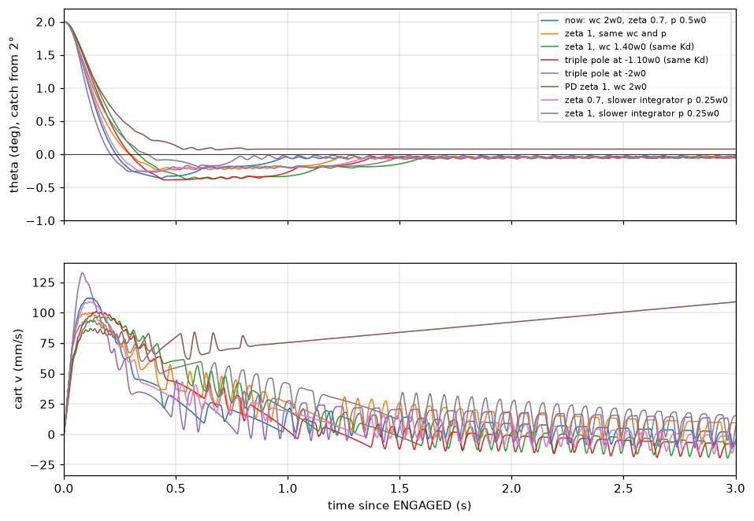

# Gate B report (DRAFT, 2026-10-12)

**Status:** everything the brief asks for at Gate B, except the actuator capability (0.9), which needs
the new PCB (arrives Wed 2026-10-14; it also fixes the intermittent microstep mode). Values that depend
on 0.9 are marked **PENDING 0.9**; the analysis is set up so that they only have to be filled in.
Simon decides at the gate whether Stage 1 catches may start.

## 1. Measured parameters

| Parameter | Value | Uncertainty / evidence | Source |
|---|---|---|---|
| Encoder resolution | 2400 counts/rev | exact: 5 turns = 12 000.5 counts, return −1 count | 0.6 (`docs/stage0_6_7_10_results.md`) |
| Encoder integrity | no lost or wrong-type edges in 0.7 M events | 2 startup/race bugs found and fixed (§3) | 0.6 |
| θ sign (`calib.theta_sign`) | +1 (θ > 0: top toward +x) | confirmed three ways: hand test, shadow upright tilt, pulse/damping | 0.6, Stage 1 |
| x sign (`calib.x_sign`) | +1 (+x = increasing steps = toward the LEFT switch) | switch runs; combined sign confirmed by the pulse fit (k > 0) | 0.8 |
| ω₀ (hanging, small angle) | 4.931 rad/s | ± 0.01 (8 decay segments 4.914–4.940) | 0.10 |
| L_eq = g/ω₀² | 0.4035 m | ± 0.002 | 0.10 |
| Viscous b/J | 0.024 1/s | ~± 50 %, irrelevant (design 2ζω_c ≈ 14 1/s) | 0.10 |
| Coulomb γ | 0.0117 rad/s² (stiction band ± 0.18 counts) | ~± 30 % | 0.10 |
| Input gain ω₀²/g | 2.48 1/m | pulse fit 93 %, damping decay 103 % → ± 7 % | 0.10 (`docs/stage1_damp.md`) |
| Upright reference c_bottom | fitted at every start (swing 2–20°) | ± 0.13 counts within a run (5–14° swings); two starts with 15–20° swings differed by 0.28 counts | 0.7, Stage 1 |
| Cart scale | 13 333 steps/m (1/8 step) | ruler ± ~5 %; **step mode intermittent** (half-step seen: 3072/m) | 0.8; PCB fixes |
| STEP toggles per step | 2 | 1.9985 measured | 0.8 |
| Track | switches ~0.5 m apart; soft limits ± 0.15 m about the centre | rough (tape) | 0.8 |
| Control loop timing (SCHED_FIFO 80, core 1) | lateness p99 6 µs idle / 35 µs load, max 0.33 ms | 10 min runs, no overruns | 0.5 |
| Step-edge timing (FIFO 90, core 3) | p99 ≤ 12 µs, rare 0.1–0.3 ms bursts | scope check passed | 0.5 |
| Encoder read latency | p50 33 µs, p99 50 µs | kernel timestamps share CLOCK_MONOTONIC | 0.6/0.11 |
| Velocity estimator | BD + 2nd-order Butterworth 20 Hz | chosen on real data (`docs/stage0_11_estimators.md`) | 0.11 |
| Simulation | validated: pulse peak 100 %, damping decay 1.022 vs 1.019 1/s, φ RMS 0.12° | `docs/stage0_12_sim.md` | 0.12 |
| a_max, v_max (reliable), a_brake, effective actuator delay, step-loss limits | **PENDING 0.9** | | 0.9 |

## 2. Plots
- Identification and integrity: `docs/img/` from `py/fit_swing.py`, `py/encoder_report.py` (0.6/0.7/0.10).
- Pulse and damping on the rig: `logs/2026-10-09T13-48-40_move/pulse.png`, `logs/2026-10-09T13-50-13_damp/damp.png`.
- Simulation vs rig: `docs/img/sim_validation.png`.
- Estimators on real data: `docs/img/estimators_real.png`.
- Design: `docs/img/gateb_catch_region.png` (catch regions), `docs/img/gateb_nyquist.png` (Nyquist, proposed design).

## 3. Issues found and fixed
| Issue | Evidence | Fix |
|---|---|---|
| Original code (Gate A items 1–13, N1–N9): uninitialised flags, non-atomic shared state, limit switches never stop motion, ×2 unit mix, old decoder holds the newest edge, normal-priority step thread | `docs/gateA_report.md` | Bring-up mode and signal handling in `main`; new `pendctl` runtime: atomics, SCHED_FIFO + pinning, own supervisor and soft limits (Axis raw position), units at the boundary, new edge reader |
| A failed build ran a stale binary that homed the cart (2026-10-08) | incident | rm before build, `&&`-gated runs, no real-chip run without a go |
| Encoder reader lost edges at startup | recording 09-20-36 | claim lines after memory/RT setup |
| False encoder fault at reader start | runs A/B | ignore same-type events older than the start-level read |
| **"Encoder fault" while lifting fast** (edge arriving during the drain counted as overflow) | shadow 14-38-54 | overflow only when edges are lost or the buffer is full |
| Calibration never timed out (clock wrap before the first tick) | mock run on the Pi | fixed, mock timeout added |
| Shadow armed on the estimator's first (zero) sample | mock run | first arm after 0.2 s |
| Start-up calibration rejected natural 10–20° swings | shadow 13-24-19 | amplitude-corrected frequency (validated on the free decay), accept 2–20° |
| Steps/m 4× off and intermittent (half-step vs 1/8) | 307 steps → 23 mm vs 1526 steps ≈ 0.5 m | config 13 333; distance check before motion; **new PCB** |
| D-term spikes ± 2.4 m/s² per count step | shadow 13-36-33 | BD+LP2 20 Hz: spikes 2.4× lower, closed-loop noise halved |
| Drift: integrator enable delay cost 42 mm/s | `docs/stage1_drift.md` | `ctrl.i_delay = 0` |
| Engage on release: hand adjustments looked like releases | shadow 14-38-54 (both engages false) | **open**: feature off, edge log for labelled tuning |

## 4. Proposed Stage 1 design
| Item | Proposal | Reason |
|---|---|---|
| Ts | 2 ms (500 Hz) | timing margin large (p99 35 µs under load); ω_c·Ts = 0.02 |
| Controller | PID, pole placement (s² + 2ζω_c s + ω_c²)(s + p), **ω_c = 2ω₀ = 9.9 rad/s, ζ = 0.7, p = 0.5ω₀** | table below |
| Gains | **Kp 62.8 (m/s²)/rad, Ki 96.7 (m/s²)/(rad·s), Kd 6.56 (m/s²)/(rad/s)** | Kp = 6.4 g > g |
| Velocity | BD + LP2 20 Hz on counts (`ctrl.estimator = bdlp2`) | 0.11 |
| Integrator | runs from engage (`i_delay = 0`), conditional integration in saturation, clamp \|Ki·I\| ≤ 1 m/s² | drift budget |
| a_max, v_max | **PENDING 0.9**: 50–70 % of the reliable maxima (placeholders 3 m/s², 0.5 m/s) | brief |
| Supervisor | engage \|θ\| < 4°, \|ω\| < 0.5 rad/s for 50 ms; abort \|θ\| > 22°, soft limits ± 0.15 m with braking distance at a_brake (**PENDING 0.9**, placeholder 1 m/s²), switch, encoder fault, Axis not in ACCELERATE, 3 overruns, 60 s | brief §6 |
| Engage on release + momentum pre-load | built, sim-tested, **off** | false engages from hand adjustments |
| Start-up calibration | free swing 2–20° (5–10° recommended), fit at every start | no encoder index |

### Predicted margins (linear analysis with the LP2 filter, exact ZOH, 0.5 ms compute delay; `py/gateb_design.py`)
| Design | Kp / Ki / Kd | Gain margin [k_lo, k_hi] | Phase margin | Delay margin | RMS a from quantisation | 3° catch (nonlinear sim): RMS a / p99 / RMS θ |
|---|---|---|---|---|---|---|
| PID ω_c = 1.5ω₀ | 42.2 / 54.4 / 5.16 | [0.33, 9.0] | 49° @ 13.6 rad/s | 63 ms | 0.15 m/s² | 0.36 / 0.87 / 0.069° |
| **PID ω_c = 2ω₀** | **62.8 / 96.7 / 6.56** | **[0.25, 6.9]** | **50° @ 18.0 rad/s** | **48 ms** | **0.19 m/s²** | **0.47 / 1.12 / 0.057°** |
| PID ω_c = 3ω₀ | 118.7 / 217.7 / 9.34 | [0.16, 4.7] | 47° @ 27.1 rad/s | 30 ms | 0.30 m/s² | 0.70 / 1.66 / 0.042° |
| PD ω_c = 2ω₀ | 49.1 / 0 / 5.56 | [0.20, 8.3] | 51° @ 15.5 rad/s | 57 ms | 0.16 m/s² | 0.43 / 0.94 / 0.048° |

All: Nyquist one counter-clockwise encirclement of −1 for one unstable open-loop pole (stable). The linear
LP2 model matches a direct time simulation to 1e-16.

**Trade-off:** ω_c = 3ω₀ catches no more (below) but halves the delay margin and raises the command noise
by 50 %; 1.5ω₀ is quieter with more delay margin but holds the angle less tightly. 2ω₀ keeps 48 ms of delay
margin for Stage 2 latency, a ×4 gain margin downward and ×7 upward (covers the ± 7 % input-gain uncertainty
and the ± 5 % steps/m uncertainty many times over). If 0.9 shows step loss at the noise level, fall back to
1.5ω₀.

### Catch region (`docs/img/gateb_catch_region.png`)
With the placeholder limits (3 m/s², 0.5 m/s) every design catches the same region: **θ₀ + θ̇₀/ω₀ ≲ 10°**
(9.5° at rest, 6.5° moving away at 0.25 rad/s, 3.5° at 0.5 rad/s). The boundary slopes at exactly 1/ω₀:
the pendulum's unstable mode z = θ + θ̇/ω₀ must stay within what the actuator can still turn around. **The
catch region is set by the actuator limits, not the gains**, so it is recomputed with the 0.9 values.

### Drift (`docs/stage1_drift.md`)
- Residual cart velocity after a catch: ≈ 0 for PID with a clean release (sim), 68 mm/s for PD (brief §3
  confirmed); each 50 ms of hand on the rod after engage adds ~90 mm/s.
- Reference offset δ: PID a_d = gδ; PD a_d = gδ·Kp/(Kp − g):

| δ | PID: a_d, time to 0.15 m | PD: a_d, time to 0.15 m |
|---|---|---|
| 0.25 count (0.65 mrad) | 6.4 mm/s², 6.8 s | 8.0 mm/s², 6.1 s |
| 0.5 count (1.31 mrad) | 12.8 mm/s², 4.8 s | 16.1 mm/s², 4.3 s |
| 1 count (2.62 mrad) | 25.7 mm/s², 3.4 s | 32.1 mm/s², 3.1 s |

The quantisation limit cycle alone gives up to ± 6 mm/s² (where upright falls in the count grid), and the
trim reduces it only within a branch (discontinuous). Expected balanced runs: ~4–7 s before a soft limit.

## 5. Proposed acceptance thresholds (Stage 1 experiments)
| Metric | Threshold | Prediction |
|---|---|---|
| Catch success, ~2° release, each side | ≥ 9/10 | inside the region with large margin |
| Catch success, ~5° release, each side | ≥ 8/10 | inside (z < 10°) |
| Catch success, ~8° release, each side | ≥ 5/10, or recomputed after 0.9 | near the edge of the region |
| Settling | \|θ\| < 3° within 1 s of release (brief) | 3° catch: \|θ\| < 1° after ~0.5 s |
| RMS θ after 1 s | ≤ 0.3° | 0.06° (sim) |
| Saturated fraction after 1 s | ≤ 5 % | 0 % (sim) |
| Balanced time before a soft limit or timeout | median ≥ 3 s with the untrimmed reference; improves with trim | 4–7 s |
| Faults | 0 encoder faults, 0 overrun aborts, no step loss (post-run switch audit within ± 10 steps) | |
| Trim | \|a_d\| ≤ 6 mm/s² (≈ 0.25 count) within 3 iterations | discontinuous near a branch jump |
| PD vs PID | PD residual velocity matches g∫θ of the catch within 50 % | 68 mm/s for a 3° catch |

## 6. Before the first catch
1. **New PCB (Wed):** pin map check (`pins.*`), microstep mode check with a measured move (expect 1/8, 13 333/m).
2. **Motor-only E-stop with a bulk capacitor at VMOT** (Gate A N8: the 1 A fuse and the remote bulk cap) before
   the aggressive 0.9 runs, unless the PCB provides it.
3. **0.9 actuator capability** with the pendulum mounted: moves at increasing accel/speed with a step-loss
   audit after each, then 500 Hz acceleration streams (steps, chirp): reliable maxima, effective delay,
   Axis cap. Set a_max, v_max to 50–70 % of the reliable maxima, a_brake, and re-run `py/gateb_design.py`.
4. Fill in the PENDING values here, re-run the catch region, finalise the thresholds.
5. Operator procedure: calibration swing 5–10°; lift to within ~2° of upright, hold still, let go the moment
   it engages (hand-hold drift), hands ready to catch.

## 7. Decisions for Simon at the gate
- Approve the design (PID ω_c = 2ω₀, LP2 20 Hz, Ts 2 ms) or pick another row.
- Approve the acceptance thresholds.
- Engage logic: keep "still near upright" (release promptly), or a labelled shadow session to tune engage-on-release.
- After 0.9: approve a_max, v_max, a_brake and the first-catch limits (brief: reduced a_max and v_max first).

## Appendix: a critically damped controller? (2026-10-14, `py/zeta_study.py`)

Question (Simon): tune the upright loop to be critically damped, ζ = 1 instead of 0.7.

Pole placement gives (s² + 2ζω_c s + ω_c²)(s + p), so ζ = 1 makes the dominant pair a real double pole, and
p = ω_c as well puts all three poles together. **But the angle still overshoots after a catch, whatever the poles.**
- The PID only rests when Ki·∫θ = 0. The integrator starts at 0 at engage, so after a catch from +θ₀ the angle has
  to spend as much area below zero as it spent above.
- This is the same conservation that sets the cart velocity: v∞ = v₀ + L_eq θ̇₀ + g∫θ (`docs/stage1_drift.md`).
- Only PD (Ki = 0) can approach upright monotonically. It then keeps the cart moving at g∫θ.

Demo limits (a_max 2, v_max 0.3), BD+LP2 20 Hz, Ts 2 ms; catches in the validated nonlinear simulation:

| Design | Kp / Ki / Kd | Poles (1/s) | GM [lo, hi] | PM | DM | RMS a, quantisation | 2° catch: overshoot / settle to 0.2° | Cart v after 3 s |
|---|---|---|---|---|---|---|---|---|
| **now**: ω_c 2ω₀, ζ 0.7, p 0.5ω₀ | 62.8 / 96.7 / 6.56 | −6.9±7.0j, −2.5 | [0.25, 6.9] | 50° | 48 ms | 0.19 | 18 % / 0.71 s | −4 mm/s |
| ζ 1, same ω_c and p | 68.7 / 96.7 / 8.94 | −9.9 (×2), −2.5 | [0.20, 5.2] | 55° | 40 ms | 0.27 | 12 % / 1.04 s | +3 |
| ζ 1, ω_c 1.40ω₀ (same Kd) | 42.8 / 47.4 / 6.56 | −6.9 (×2), −2.5 | [0.29, 7.2] | 57° | 59 ms | 0.19 | 19 % / 1.30 s | −13 |
| triple pole at −1.10ω₀ (same Kd) | 45.4 / 64.4 / 6.56 | −5.4 (×3) | [0.30, 7.2] | 56° | 57 ms | 0.19 | 19 % / 1.14 s | −14 |
| triple pole at −2ω₀ | 127.5 / 387 / 11.9 | −9.9 (×3) | [0.18, 3.7] | 48° | 25 ms | 0.39 | 13 % / 0.60 s | +4 |
| PD, ζ 1, ω_c 2ω₀ | 49.1 / 0 / 7.95 | −9.9 (×2) | [0.20, 6.0] | 59° | 49 ms | 0.23 | **0 %** / 0.43 s | **+117** |
| ζ 0.7, slower integrator p 0.25ω₀ | 55.9 / 48.4 / 6.06 | −6.9±7.0j, −1.2 | [0.23, 7.5] | 50° | 52 ms | 0.18 | 13 % / 0.90 s | −9 |
| ζ 1, slower integrator p 0.25ω₀ | 58.9 / 48.4 / 8.45 | −9.9 (×2), −1.2 | [0.20, 5.6] | 57° | 44 ms | 0.25 | 11 % / 1.12 s | +6 |

Reading:
- **ζ = 1 alone hardly changes the overshoot** (18 → 12 %) and settles slower. At the same bandwidth it raises Kd by 36 %: 40 % more quantisation buzz and 8 ms less delay margin.
- At the same Kd (same buzz) it means a lower bandwidth: about the same overshoot, and slower.
- The overshoot is set by the **integral pole p**. A slower integrator gives a shallower, longer undershoot (13 % at p = 0.25ω₀), at the price of a slower velocity correction (−9 mm/s after 3 s).
- In absolute terms it is 0.25–0.4° on a 2° catch, about 1–1.5 counts, below what anyone sees on the rig.
- **PD ζ = 1** is the textbook critically damped catch with no overshoot. It leaves the cart at +117 mm/s after a 2° catch, enough to reach the soft limit in about 1–1.5 s. This is the PD-versus-PID trade from brief §3.

**Recommendation:** keep ζ = 0.7, ω_c = 2ω₀, p = 0.5ω₀. If a slightly calmer catch is wanted, p = 0.25ω₀ is the knob, not ζ.

On the rig the variants are config overrides; each run needs Simon's go:
- `./demo.sh --set ctrl.zeta=1.0` (margins fine; expect a louder buzz);
- `--set ctrl.p_over_w0=0.25` (slower integrator);
- `--set ctrl.p_over_w0=0 --set ctrl.zeta=1.0` (PD: a visibly clean catch, then the cart runs off). This one is worth showing only as the contrast.

### Why ζ = 0.7 (`py/zeta_sweep.py`: ζ swept at ω_c = 2ω₀, p = 0.5ω₀)

| ζ | Kd | RMS a, quantisation | GM [lo, hi] | PM | DM | Ms = max\|S\| | Mt = max\|T\| | 2° catch: overshoot / settle |
|---|---|---|---|---|---|---|---|---|
| 0.4 | 4.17 | 0.13 | [0.33, 10.4] | 35° | 46 ms | 1.68 | 2.10 | 34 % / 0.50 s |
| 0.5 | 4.96 | 0.15 | [0.30, 8.9] | 41° | 49 ms | 1.43 | 1.83 | 25 % / 0.53 s |
| 0.6 | 5.76 | 0.17 | [0.27, 7.8] | 46° | 49 ms | **1.31** | 1.66 | 19 % / 0.58 s |
| **0.7** | 6.56 | 0.19 | [0.25, 6.9] | 50° | 48 ms | **1.31** | 1.55 | 18 % / 0.71 s |
| 0.8 | 7.35 | 0.22 | [0.23, 6.2] | 52° | 46 ms | 1.33 | 1.46 | 12 % / 0.87 s |
| 1.0 | 8.94 | 0.27 | [0.20, 5.2] | 55° | 40 ms | 1.39 | 1.35 | 12 % / 1.04 s |
| 1.2 | 10.53 | 0.32 | [0.18, 4.5] | 55° | 35 ms | 1.46 | 1.28 | 12 % / 1.14 s |

- Ms is the largest amplification of any disturbance by the loop, and 1/Ms is how close the Nyquist curve comes to −1.
  It is a single robustness number that covers gain and phase errors together. **It is smallest at ζ = 0.6–0.7**
  (1.31, so the curve stays 0.76 away from −1).
- **Below 0.6** the dominant pair rings: Mt rises to 2.1 and the phase margin falls to 35°.
- **Above 0.8** the larger Kd raises the buzz, and the upper gain margin and the delay margin shrink, so Ms rises again.
- Mt stays above 1 even with real poles. An open-loop unstable plant forces some peaking, and so does the integrator's zero.
- 0.7 takes the end of the flat optimum with the larger phase margin (50° against 46°). It is also the textbook
  1/√2: maximally flat, about 5 % overshoot of the pure pair, and the fastest settling into a 5 % band.

### Continuous-time design, discrete controller: when is that valid? (`py/ts_study.py`)

The gains come from pole placement on the continuous model. The controller runs every Ts with a zero-order hold
and a compute delay τ = 0.5 ms (emulation design). Holding each command for a whole period acts like a delay of
about Ts/2. Together with τ, that costs a phase of about (Ts/2 + τ)·ω at frequency ω.

Criterion: the continuous design carries over when that loss at the gain-crossover frequency ω_gc is small
compared with the phase margin, i.e. **ω_gc·Ts ≪ 1**. Common rules of thumb say to sample 20–30× the closed-loop
bandwidth (ω_gc·Ts ≲ 0.2–0.3); below about 0.1 the discrete loop is practically the continuous one. The plant's
fastest pole matters too: the unstable pole at ω₀ gives ω₀·Ts = 0.01. The same gains run in the exact discrete
loop (ZOH, delay, BD+LP2 filter at min(20 Hz, f_s/10)):

| Ts | f_s | ω_gc·Ts | ZOH + delay lag at ω_gc | PM | GM [lo, hi] | DM | Dominant poles s = ln z / Ts |
|---|---|---|---|---|---|---|---|
| 0.5 ms | 2000 Hz | 0.009 | 0.8° | 51° | [0.25, 8.3] | 49 ms | −2.5, −9.0±6.5j (≈ continuous limit) |
| 1 ms | 1000 Hz | 0.018 | 1.0° | 50° | [0.25, 7.8] | 49 ms | −2.5, −9.1±6.4j |
| **2 ms** | 500 Hz | **0.036** | **1.5°** | 50° | [0.25, 6.9] | 48 ms | −2.5, −9.3±6.4j |
| 5 ms | 200 Hz | 0.091 | 3.1° | 47° | [0.25, 5.4] | 45 ms | −2.5, −10.0±6.2j |
| 10 ms | 100 Hz | 0.196 | 6.2° | 33° | [0.25, 2.4] | 30 ms | filter at 10 Hz: −2.6, −8.2, −16.6±25.2j |
| 20 ms | 50 Hz | 0.410 | 12.3° | 1° | [0.25, 1.0] | 0 | on the edge (filter at 5 Hz) |
| 30–40 ms | ≤ 33 Hz | — | — | unstable | — | — | — |

- At **Ts = 2 ms**, ω_gc·Ts = 0.036. The crossover is at 18 rad/s (2.9 Hz), sampled 175× faster. Sampling costs
  1.5° of phase and 1 ms of delay margin, so the continuous design is justified with a wide margin.
- The design breaks down around ω_gc·Ts ≈ 0.2 (10 ms). Part of that is the velocity filter, which has to move
  down with the Nyquist frequency.
- The larger approximation in the continuous design is not sampling but the **velocity filter**, which the pole
  placement leaves out: 12° of lag at crossover. It moves the dominant pair from the designed −6.9±7.0j to about
  −9±6.5j, which is the Ts → 0 limit above.
- That is why the design is always checked on the exact discrete model with the filter and delay (margins
  above, `py/gateb_design.py`), and on the nonlinear simulation and the C++ runtime. Design in s for insight
  and closed-form gains (Kp > g, …); verify in z.
