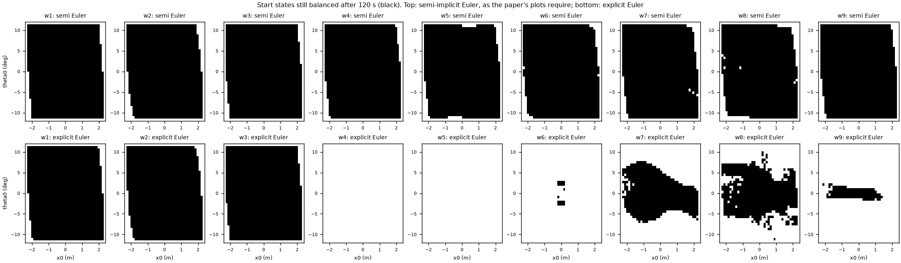

# Evolved recurrent neurocontrollers in simulation (Pasemann 1998, ENS³)

Status 2026-11-19: simulation only, started at Simon's request ("Start in simulation"). It is a separate method with its own
script: `py/neuro/`, `py/neuro_check.py`, `py/neuro_evolve.py`, `py/test_neuro.py`, `./neuro_sim.sh`. It changes nothing
in `py/pendel`, the Pi runtime, `demo.sh`, `remote.sh` or `swingup.sh`. Nothing here talks to the Pi.

## How to run (PC)

```
./neuro_sim.sh test                          # 14 checks, incl. rig model = pendel.plant / pid_step / BdLp2 exactly
./neuro_sim.sh check --png docs/img/neuro_benchmark.png
./neuro_sim.sh evolve bench --inputs 4 --gens 1000
./neuro_sim.sh evolve rig --rig-inputs 4 --gens 600 --seed 1
./neuro_sim.sh rig logs/<run>/best.json --baseline
.venv/Scripts/python py/neuro_check.py replay logs/<run>/best.json logs/<time>_balance
```

## 1. The paper reproduces, but only with one reading of its simulator

The weights were decoded from the PDF's text layer with its character spacing honoured. The plain text runs numbers
together, so, for example, w¹'s "15.1 19.97" can otherwise be read as "15.11 9.97". Each network was then run on
the paper's 40 × 40 grid of start states for 120 s.
Simulated with the network's new output applied in the same step and **semi-implicit Euler**, all nine networks
balance 94–97 % of the 1444 squares inside the limits, and they behave as the paper describes. w¹ centres in 4 s.
w⁴'s cart keeps oscillating with a large, constant amplitude. w⁵ settles after 43 s (the paper: under 60 s). w⁸
keeps the pole oscillating.

| net | semi-implicit, output at once | explicit Euler | output one step late |
|---|---|---|---|
| w¹–w³ (4 inputs) | 95–97 % | 95–97 % | 95–97 % |
| w⁴, w⁵, w⁶ (x, θ only) | 96–97 % | 0–1 % | 0 % |
| w⁷, w⁸, w⁹ (x, θ only, s-class) | 94–96 % | 8–49 % | 7–25 % |



The 2-input networks only work because the integrator adds no energy. Their recurrent "velocity estimate" gives
very little damping: w⁴'s self-loop adds about 5 ms of lead, and its pole oscillation takes about 15 s to die out,
as in the paper's figure 6b. Explicit Euler, the formula the explainer doc gives in its section 2, or a single step
of delay is enough to make them fall. Expect the same margin problem on the rig, which has 8 ms of delay.
ENS³ exploits the same thing on the benchmark: within 40 generations it found a 1-neuron, 3-synapse network
(angle plus an inhibitory self-loop) that balances 97 % of the grid.

## 2. The rig model

`py/neuro/rig.py` mirrors `pendel.plant` (pendulum, Axis cap, quantised encoder), `pid_step`'s saturation with the
v_max taper, the Pi's BD+LP2 velocity estimator at 14 Hz, the supervisor's soft limit with braking distance, the
22° abort and a constant command delay. The test checks each of these against the originals exactly.
Validation, with the rig's own controller (`rig.PidPolicy` = `cascade_step` with the config gains), over 200 runs of 20 s:

| controller | training draws | test draws (ref ±2 counts, w0 ±3 %, friction ranges, delay 4–7) |
|---|---|---|
| PID + cart loop (Stage 3b) | 91 % survive, end ~9 mm | 78 % survive, end ~11 mm |
| angle-only PID (Stage 1) | 1 % (drifts into the soft limit by ~2 s) | 0 % |

This matches `py/cascade_study.py` and the rig's history (Stage 1 drifted; the cart loop fixed it).

## 3. Evolution results

The networks start empty, as in the paper. Runs from 2026-11-19 are in `logs/2026-11-19T11-*_neuro-*` (`best.json`,
`summary.json`, `log.csv`).

**Benchmark: ENS³ finds the paper's answers again.** With 4 inputs, after 1000 generations the best network is one
output neuron, w = (0.13, 8.55, 11.90, 15.01, 2.22). That has w¹'s structure and signs and close to its gains (w¹: 10.11,
15.1, 19.97, 2.99), and it balances 1388 grid squares (w¹: 1390). With 2 inputs, after 3000 generations the best network
is w⁴'s architecture, (θ: 23.52, x: 0.34, self-loop −0.58), which balances 1398 squares (w⁴: 1396).

**Rig model.** Each network is scored on 300 fresh runs of 30 s drawn from `rig.TEST`: unseen plants (w0 ±3 %,
b/J 0.03–0.08, Coulomb 0.10–0.25), reference errors to ±2 counts and delays of 4–7 ticks. The runs come from seed 7,
not from the set the winners were picked on.

| controller | survived 30 s | median end abs x | mean abs a | command changes |
|---|---|---|---|---|
| rig PID + cart loop (Stage 3b, `cascade_step`) | 81 % | 6 mm | 0.18 m/s² | 4.9 /s |
| evolved, 4 inputs (x, θ, v, Pi's ω), seeds 1–3 | 85 % each | 14–17 mm | 0.29–0.35 m/s² | 8.0–10.4 /s |
| evolved, 3 inputs (x, θ, v; ω by recurrence), best seed | 52 % | 20 mm | 0.80 m/s² | 7.3 /s |
| evolved, 3 inputs, the other two seeds | 4 %, 1 % | – | – | – |

With the Pi's velocity estimate available, all three seeds converged on the same single neuron with no recurrence,
w = (bias ≈ 0, x 1.0–1.3, θ ≈ 9, v ≈ 2, ω ≈ 1.2). In physical units that is full-state feedback,
a ≈ 88 θ + 12 ω + 17.5 x + 12.5 v. Compare the PID's 63 θ + 6.5 ω, and its cart loop's 2.6 x + 6.4 v plus an integral.
Its strong cart terms replace the integral: a reference error δ parks the cart at about 5 δ (26 mm for 2 counts)
instead of 24 δ for the P cart loop. It survives slightly more runs than the PID, at about 1.7× the control effort and
twice the command changes. Without ω, evolution has to build a velocity estimate from 100 Hz quantised angles. One seed
in three found a usable 2-neuron recurrent network, and it is far weaker.

## 4. Replay of logged rig runs (open loop)

`./neuro_sim.sh` → `py/neuro_check.py replay NET.json logs/<run>`. The network sees the logged x, θ, v and ω of every
balancing stretch and its command is compared with the one the PID sent. This checks that the network behaves sensibly
on real sensor data. It cannot show closed-loop behaviour, because the logged trajectories were the PID's.

| network | session | stretches | corr with PID | rms command: PID / net | at its limit |
|---|---|---|---|---|---|
| 4 inputs (seed 1) | 2026-11-04T10-16-08 (swing-up, Stage 3b) | 3 × 30 s | 0.29–0.40 | 0.34–0.38 / 0.75–0.77 m/s² | ≤ 0.4 % |
| 4 inputs (seed 1) | 2026-11-03T14-32-03 (remote, Stage 3) | 48 s, 5 s, 60 s | 0.35–0.58 | 0.33–0.68 / 0.99–1.21 m/s² | ≤ 5 % |
| 3 inputs (seed 2) | 2026-11-03T14-32-03 | same | −0.01–0.23 | 0.33–0.68 / 1.57–1.72 m/s² | 23–39 % |

The 4-input network is plausible on real data: bounded, rarely saturated, about as smooth per update as the PID, and
2–3 times as aggressive (mostly its cart terms reacting to the ±100 mm the PID let the cart wander). The 3-input
recurrent network is not: its output is unrelated to the PID's and pinned at its limit a quarter of the time. Its
recurrent velocity estimate does not survive real quantisation and vibration. That is the same thin margin as section 1.

## 5. Where this stands

- Section 8 of the explainer, steps 1–4, are done in simulation (steps 3 and 4 above).
- A rig candidate exists: the 4-input network (`logs/2026-11-19T11-14-39_neuro-rig-4t-s1/best.json`). It is a static
  linear controller, so it is effectively an evolved LQR, not a recurrent one. Pasemann's recurrent, angle-only idea does
  not carry over to this rig as it stands.
- Before any rig run: lower its effort (a higher cost on mean |a| and on command changes), re-evolve with the
  remote path's delay stalls, and give it its own PC program plus its own launcher script beside `remote.sh`
  (not `swingup.sh`). Then it needs Simon's go for that specific run. None of this is built yet.
